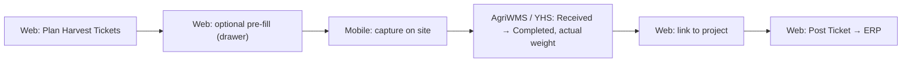

# Harvest Central: Plan, Capture and Post Harvest Tickets

**Who:** Farm Operations Manager (web); Supervisor or permitted Machine Operator (mobile)  **Where:** Web plans, reviews and posts. Mobile captures each load on site.

A **harvest ticket** records one truck load leaving a field: field and variety, load type, trailer and truck plates, driver, and the weight. The Manager **plans** the expected loads in advance on web. The crew **captures** each ticket on mobile when the truck arrives. AgriWMS (YHS Receiving) returns the actual weight, and the Manager **links** the ticket to the ERP project and **posts** it.

This page follows the **Harvesting (Permanent Planting) PSD v2.0** (Aug 2026). That is a separate flow from the [harvest work order](../work-orders/create-harvest-work-order) the crew runs.

:::warning What the current build shows (QA, 12 Oct 2026)
The detail page, row actions and ticket numbers already match this page. Some screens still differ from the v2 design:
- The plan panel is titled **Plan Harvest Tickets** and asks for **No Of Harvest Tickets \***. From the list it shows no **Farm**, and **Variety** is a single pick from every variety.
- The edit drawer is titled **Edit Harvest Ticket**. Its split options are **Front Only** / **Back Only**. It needs **Driver Name**, **Truck License Plate** and the trailer plates before **Save Harvest Ticket** is enabled.
- There is no **Fleet** column yet.
:::

## Before you start

:::note Prerequisites
- Harvesting is enabled for your tenant, and your role has harvest-ticket permission (**Manage Harvest Ticket**). Without it, the create options are hidden on web and mobile.
- The correct **Site** and **Season** are selected in the header. The Field list is filtered by Site.
- The field/variety block belongs to an ERP project. Tickets can't be posted without a project link.
:::

## 1. Plan the loads (web)

1. Click **Harvest Central** in the top navigation. The list shows one row per **Field** + **Variety**, with **No. of Planned Tickets**, **No. of Actual Tickets**, **Planned On** and **Planned By**.
2. Click **Plan Harvest Tickets**. To add loads to an existing block, open its detail page and click **+ Plan Harvest Tickets** there; Field and Variety are then fixed.
3. In **Plan Incoming Loads**, check the defaulted **Grower**, **Farm**, **Season** and **Hulling Location**.
4. Choose **Field \***, then one or more **Variety \*** values. Only that field's varieties are listed.
5. Under **Enter Quantity \***, click **10**, **20** or **30**, or type a number. The limit is **100** per plan.
6. Click **Create N Planned Tickets**.

N tickets are created **for each selected variety**, each with a system ticket number (for example `HT-321-HB12-26`). Until a load is captured, its **Load Type** shows **Set on site**.

## 2. Pre-fill what you already know (web, optional)

On the detail page (**›** on a row), click **Edit** on a ticket to open the **Harvest Ticket &lt;number&gt;** drawer. You can set:
- **Manual Ticket #**: the number on the paper ticket (optional).
- **Load Type**: **Last load** or **Split load**. With **Split load**, choose **Front trailer** or **Rear trailer**. The other trailer's plate is disabled and shows *Not needed — split load*.
- **Front Trailer License Plate**, **Rear Trailer License Plate**, **Driver Name** and **Truck License Plate**, all picked from the fleet list.
- Standard quantity and attachments.

For a load that hasn't arrived yet, these values pre-fill the crew's on-site form, and the crew can still change them.

## 3. Capture the load (mobile)

1. Open the waiting tickets: the **Harvest Central** tile, or **+** → **Harvest Ticket**.
2. Pick the field/variety block. It shows **pending / planned**, for example `4/5`. Open **In Progress**.
3. Tap the ticket for the arrived load.
4. **Step 1 – Load type & trailers:** enter **Manual Ticket #**. Tick **Split Load** if only one trailer came, and pick Front or Rear trailer. Select the trailer plates, then tap **Next — driver & truck**.
5. **Step 2 – Driver & truck:** select **Driver** and **Truck License Plate**. Turn on **Last Load** if this is the final load from the plot.
6. Tap **Submit ticket**. Use **Save & exit** to finish later.

Submitted tickets move to the **Completed** tab, where you can reopen one to fix a wrong driver or plate. Capture works offline; tickets sync automatically when the connection returns.

## 4. Review, link and post (web)

1. On the detail page, review the captured tickets. The summary line shows how many are *planned · in progress · received · posted*. **Actual Weight** and the **Completed** chip come from YHS and are read-only. **Fleet** follows the selected truck.
2. Adjust or delete tickets if needed. You can only do this **before** YHS marks the ticket Completed.
3. Select the tickets, link them to the project, and click **Post Ticket**.

## How Load Type is set

| You choose | Load Type shown |
|---|---|
| Nothing, first load of the field/variety | **First Load** |
| Nothing, any later load | **In Progress** |
| Split load (front), first load | **First Load - Split Front Load** |
| Split load | **Split Load (Front)** / **Split Load (Rear)** |
| Last load | **Last Load** |
| Not captured yet | **Set on site** |

If the field/variety already has a Last Load, a second one asks **A Last Load already exists**. **Confirm** moves the earlier ticket back to **In Progress**.

## Notes & gotchas

- **Missing data blocks posting, not saving.** An incomplete ticket saves, but **Post Ticket** refuses it until the details are filled in.
- **Completed means locked.** After YHS completes a ticket, it can't be edited or deleted. Edits made before then, including deletions, are synced to YHS.
- **QR code:** each ticket has a QR code on the detail screen, with **Download** so you can share it in chat.
- Ticket changes appear in the audit log (notifications → view all logs).
