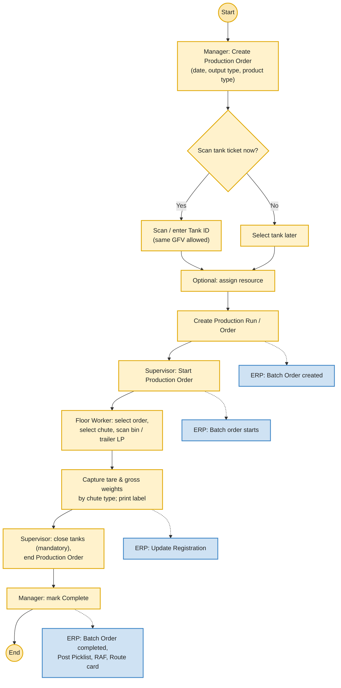
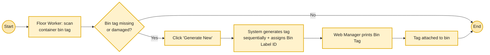
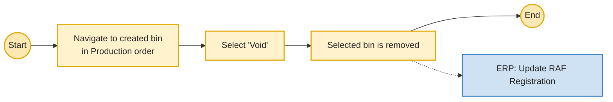

# AgriProduction Production Management

**For Nut Processors - Desktop, Kiosk & Tablet App**

Product Specifications Document — V 1.0

---

## Table of Contents

- [AgriProduction Production Management](#agriproduction-production-management)
  - [Table of Contents](#table-of-contents)
  - [Revision History](#revision-history)
  - [Executive Summary](#executive-summary)
  - [Problem Statement](#problem-statement)
  - [Solution Overview](#solution-overview)
  - [Summary](#summary)
  - [Workflows](#workflows)
    - [Pre-Cleaning Work Flow](#pre-cleaning-work-flow)
    - [Production Workflow](#production-workflow)
    - [Generate and Print Bin Tags](#generate-and-print-bin-tags)
    - [Void Bins](#void-bins)
  - [UI \& UX (Wireframes \& Designs)](#ui--ux-wireframes--designs)
    - [UI \& UX features](#ui--ux-features)
  - [App Users](#app-users)
    - [Persona 1 | Production Manager](#persona-1--production-manager)
    - [Production Manager User Journey](#production-manager-user-journey)
    - [Persona 2 | Production Supervisor](#persona-2--production-supervisor)
    - [Production Supervisor User Journey](#production-supervisor-user-journey)
    - [Persona 3 | Floor Workers](#persona-3--floor-workers)
    - [Production Floor Workers User Journey](#production-floor-workers-user-journey)
  - [Technical \& Other Details](#technical--other-details)
    - [Data Source Guidelines](#data-source-guidelines)
    - [List of Master Data](#list-of-master-data)
    - [Configurational Data and Mappings](#configurational-data-and-mappings)
    - [Key Modules \& Features](#key-modules--features)
    - [Formula Calculations](#formula-calculations)
    - [Integrations \& System Fields](#integrations--system-fields)
    - [Validation Rules, Error Handling \& Notifications](#validation-rules-error-handling--notifications)
    - [Production Setup / Settings Module \& Login Functionality](#production-setup--settings-module--login-functionality)
  - [Use Cases](#use-cases)
  - [Future Considerations](#future-considerations)
- [Updates: Version 1.1 (Draft)](#updates-version-11-draft)
  - [Precleaning Module (Web)](#precleaning-module-web)
    - [Pre-Cleaning (Web) - Main Screen](#pre-cleaning-web---main-screen)
    - [Preclean (Web) - Creation Screen](#preclean-web---creation-screen)
    - [Preclean (Web) - Details Screen](#preclean-web---details-screen)
  - [Precleaning Module (Kiosk/Tablet)](#precleaning-module-kiosktablet)
    - [Pre-Clean Dashboard - Main Screen](#pre-clean-dashboard---main-screen)
    - [Preclean (Kiosk/Tablet) - Creation](#preclean-kiosktablet---creation)
    - [Preclean (Kiosk/Tablet) - Details Screen](#preclean-kiosktablet---details-screen)
  - [Production Module (Web)](#production-module-web)
    - [Production (Web) - Main Screen](#production-web---main-screen)
    - [Production (Web) - Creation Screen](#production-web---creation-screen)
    - [Production (Web) Details Screen](#production-web-details-screen)
  - [Production Module (Kiosk/Tablet)](#production-module-kiosktablet)
    - [Production Main Screen - Kiosk/Tablet](#production-main-screen---kiosktablet)
    - [Production Detail Screen - Kiosk/Tablet](#production-detail-screen---kiosktablet)
  - [References \& Appendices](#references--appendices)
    - [Reference Spreadsheets](#reference-spreadsheets)
    - [Screenshots](#screenshots)

---

## Revision History

| Date | Released By | Version | Revision Items |
|------|-------------|---------|----------------|
| 10-Mar-26 | Aqib Malik | 1.0 | Initial Release |

---

## Executive Summary

AgriProduction (for Hullers) is an integrated Production Management System designed specifically for agricultural hullers. It digitizes the entire in-plant production lifecycle - from precleaning and production runs to yield tracking, by-product handling, and finished goods output.

AgriProduction enables real-time visibility into what is being processed, where it is in the plant, how much yield is produced, and what losses or variances occur, while staying fully synchronized with ERP and inventory systems.

This solution includes following two applications:

- ***Web Application (Huller)*** *- Production manager.*
- ***Kiosk/Tablet Application (Huller)*** *- Production supervisor, line production floor workers.*

The goal is to improve **production traceability, accuracy, compliance, and operational efficiency** through automation, real-time synchronizations, and integration with other systems.

This document defines functional behavior, workflows, system boundaries, and integration expectations for development.

---

## Problem Statement

Traditional huller operations rely on **paperwork and isolated systems** for production operations, resulting in:

- **Inaccurate** production and yield data
- **Delayed** visibility into losses, shrink, and downtime.
- **Delayed** and **unclear instructions** for Production Supervisors and Production Floor workers
- **Manual effort** to sync and **lack** of real time visibility of into other systems due to lack of integrations
- **Human errors** due to lack of weighing scale integration.

---

## Solution Overview

AgriProduction replaces manual and disconnected production processes with a **single, integrated production management and execution platform** that:

- Seamlessly integrates **plant-floor hardware** (weighing scales, barcode/QR scanners, label printers) with **digital production workflows**.
- Offers end-to-end **traceability** from **raw material & rejects intake → processing stages → finished goods output.**
- Provides **live production dashboards**, **audit logs,** and **operational reporting**.
- Real-time integration with **Dynamics 365** and other systems ensures production, warehousing, quality and inventory data stays accurate and in sync.

The following items are part of this document's scope:

- Digital production management for nut processing, including precleaning and production (hulling and shelling).
- Intake of raw materials or rejects from handlers, respecting batch attributes at every step.
- Management of production resources including operators, supervisors, processing lines, machines, and associated equipment used during production execution
- Tracking of material movement through production stages, including transitions between processing lines, tanks, bins and staging areas
- Batch- and lot-level tracking of inputs, in production inventory, production output, including yield and by-product.
- Production of output (kernels and inshells) in bins or bulk based on their designated chutes.
- Production of byproducts/ rejects such as hash and rejects received from handlers.
- Generation of new bin IDs and reuse of previous ones.
- Role-based user access for production managers, production supervisors, and floor operators, with controlled permissions by function and responsibility.
- Visibility for internal stakeholders and downstream handlers into production status, output quantities, and available finished goods inventory.
- ERP synchronization to update production output and consumption data in real time during processing and production completion.
- Tank status management is available within the AgriProduction Kiosk/Tab app, allowing users to update tank statuses (e.g., Full, In Use, Empty, Closed). All status changes are logged with user identity and timestamp and synchronized across AgriProduction and connected systems.
- Capturing and reporting of duration of each production and preclean order.
- Integration with ERP, AgriWMS and AgriQuality.
- 4 digit pin and job card scanning based log in.

The following items are **not** part of this document's scope:

- Integration with ERP to post cost of consumption on production order.
- IoT-driven automation (e.g., automated sensors, machine control, or autonomous processing), which is planned for a future roadmap phase.

---

## Summary

**AgriProduction (Processor)** is a production management application designed exclusively for agricultural processors, tightly integrated with the ERP, AgriWMS & AgriQuality systems as part of a unified end-to-end processing and operations ecosystem.

Core functionality includes:

- **Integration with plant-floor scales** to capture accurate weights at critical production and processing stages.
- **Inventory tracking across production stages**, such as raw material, pre-cleaned, in-shell, kernel, by-products, and waste streams.
- **Processing lifecycle management**, tracking material movement from intake through each transformation stage to finished goods.
- **Inventory on-hand visibility** reflecting accurate production and processed inventory positions.
- **Tracking of processed output by bins or trailers**, ensuring full traceability through to staging or shipment readiness.

---

## Workflows

### Pre-Cleaning Work Flow

Figma Link: [Pre-cleaning Process](https://www.figma.com/board/uLk10wVnQDFNkncF6TDcI1/Vann-Phase3-Internal?node-id=9921-15512&t=aVXxnffW2D5ci0pg-0)

```mermaid
flowchart LR

%% =========================
%% User Flow
%% =========================

Start((Start))
Create["Creates Pre-Clean Job"]
Scan["Scans the Stockpile ticket(s)"]
Decision{"Select tank now?"}

SelectTank["Selects the available empty tank and tank ticket will be generated"]
CreateJobTicket["Pre-clean job created and tank ticket auto generated"]

DeferTank["Tank can be selected later on when the job is created"]
CreateWithoutTank["Pre-clean job created without tank ticket"]

SelectLater["Selects the tank and tank ticket will be generated"]

ChangeTank["Change tank and print new tank ticket if needed (OPTIONAL)"]

StartClean["Starts the Pre-clean job"]

Supervisor["Supervisor will mark the job as completed"]

End((End))

Start --> Create
Create --> Scan
Scan --> Decision

Decision -->|Yes| SelectTank
SelectTank --> CreateJobTicket

Decision -->|No| DeferTank
DeferTank --> CreateWithoutTank
CreateWithoutTank --> SelectLater

CreateJobTicket --> ChangeTank
SelectLater --> ChangeTank

ChangeTank --> StartClean
StartClean --> Supervisor
Supervisor --> End

%% =========================
%% Integration Flow
%% =========================

BatchCreate["Batch order creation"]
BatchStarted["Batch order Started"]
PostPicking["Post Picking list<br/>RAF journal<br/>Route card<br/>End Batch order"]

CreateJobTicket -.-> BatchCreate
CreateWithoutTank -.-> BatchCreate

StartClean -.-> BatchStarted

Supervisor -.-> PostPicking

%% =========================
%% Styling
%% =========================

classDef user fill:#FFF2CC,stroke:#C9A000,stroke-width:2px,color:#000;
classDef integration fill:#DAE8FC,stroke:#6C8EBF,stroke-width:2px,color:#000;
classDef decision fill:#FFE699,stroke:#C9A000,stroke-width:2px;

class Create,Scan,SelectTank,CreateJobTicket,DeferTank,CreateWithoutTank,SelectLater,ChangeTank,StartClean,Supervisor user;
class BatchCreate,BatchStarted,PostPicking integration;
class Decision decision;

linkStyle 9 stroke:#E74C3C,stroke-width:2px,stroke-dasharray: 5 5;
linkStyle 10 stroke:#E74C3C,stroke-width:2px,stroke-dasharray: 5 5;
linkStyle 11 stroke:#E74C3C,stroke-width:2px,stroke-dasharray: 5 5;
linkStyle 12 stroke:#E74C3C,stroke-width:2px,stroke-dasharray: 5 5;
```

Flow (Production Supervisor → AgriProduction Kiosk/Tab): Start → Create Pre-Clean Job → Scan Stockpile ticket(s) → Decision "Select tank now?" (Yes → select available empty tank and tank ticket is auto-generated → Pre-clean job created / No → create Pre-clean job without tank ticket → select tank later and tank ticket is generated) → (Optional) Change tank and print a new tank ticket → Start Pre-clean job → Supervisor marks the job as completed → End.

Integration flow (dashed): Creating the Pre-clean job (with or without an initial tank selection) triggers ERP Batch Order creation → Starting the Pre-clean job triggers ERP Batch Order Started → Completing the job triggers Post Picking List, RAF Journal, Route Card generation, and End Batch Order.

### Production Workflow

Production
Figma link: Production Process

Flow (Production Manager / Supervisor / Floor Worker → AgriProduction Web + Kiosk/Tab): Manager creates Production Order (date, output type, product type) → Decision "Scan tank ticket now?" (Yes → scan/enter Tank ID, same GFV allowed / No → select tank later) → optional assign resource → create Production Run *(ERP: Batch Order created)* → Supervisor starts Production Order *(ERP: Batch order starts)* → Floor Worker selects order, selects chute, scans bin / trailer LP, captures tare & gross weights by chute type and prints label *(ERP: Update Registration)* → Supervisor closes tanks (mandatory) and ends Production Order → Manager marks Complete *(ERP: Batch Order completed, Post Picklist, RAF, Route card)* → End.

### Generate and Print Bin Tags

Figma Link: Generate & Print Bin Tag

Flow (Floor Worker → Production/Web Manager): Floor Worker scans container bin tag → Decision "Bin tag missing or damaged?" (No → End / Yes → click "Generate New") → system generates tag sequentially and assigns Bin Label ID → only the Web Manager can print the Bin Tag → tag attached to bin → End.

### Void Bins

Figma Link: Bin Void

Flow (Production Manager / Production Supervisor → AgriProduction Web + Kiosk/Tab): Start → Navigate to the created bin in Production order → Select "Void" → The selected bin will be removed → End. Integration flow (dashed): ERP Update RAF Registration.

---

## UI & UX (Wireframes & Designs)

Prototype Application links:

1. AgriProduction Web App
2. AgriProduction Kiosk/Tablet App

### UI & UX features

1. Column options (hide, show columns) on tables. Users will be able to add & remove columns and save it as their preference (refer prototype)
2. Sorting of the columns on tables and ability to save it as preference on user level
3. Two views of the tables i.e. table view and card view (refer prototype)
4. Drop down list view of growers, handlers, product type, variety, farming type (organic and conventional) and locations etc.
5. Scanner camera for QR code, LP and employee badge scanning.
6. Widgets for weighing scale, KPIs etc.
7. Accordions / sections to differentiate different types of fields.

---

## App Users

| App Access | Roles | Description |
|------------|-------|-------------|
| Web App | Production Manager | Responsible for monitoring the precleaning, planning / creating production orders for hulling and shelling, closing the tanks and completing the order when the production run gets completed. |
| Kiosk/Tab App | Production Supervisor | Responsible for creating and executing the precleaning jobs, manages production work by starting and pausing / stopping the production jobs for floor workers. |
| Kiosk/Tab App | Floor Workers | Responsible for executing the assigned production jobs by recording the output produced in the system. |

### Persona 1 | Production Manager

**Name:** Sarah
**Role:** Production manager

**Responsibilities:**

- Monitor the precleaning jobs. Print / reprint tank tickets.
- Managing production by creating and completing the production orders, including assigning operators. Managing tanks by closing them when the tank is emptied during production.
- Review and monitor all pending production jobs that remain incomplete.

**Challenges:**

- Using fragmented and isolated systems
- Lack of real-time status of production stages and inventory

**Goals:**

- Manage the production effectively and efficiently with timely completion of orders. Having the produced inventory ready before delivery is due.
- Have easy and automated processes that make her life easier.
- Less manual effort.
- Easy and real time visibility of the data, status and progress of the production.

### Production Manager User Journey

**User:**

1. Sarah: Production manager | AgirProduction Web Application

**View Pre-cleaning Jobs**

> **Sarah | Production Manager**

1. Sarah logs in to the AgirProduction Web App.
2. She views all the Pre-clean jobs with their status.
3. She opens a precleaning job and sees the operators, duration and other related details.
4. She prints / reprints tank tickets if needed.

**Production Orders Creation & Completion**

> **Sarah | Production Manager**

1. Sarah logs in to the AgirProduction Web App.
2. She navigates to the "Production" module in the AgirProduction Web App.
3. All Production orders with their status will be displayed
4. She creates "New Production Order' and selects:
   a. Production date
   b. Selects Output type (Inshell or Kernel)
   c. Selects Product type (Bin or Bulk)
   d. Decision: "Scan tank ticket now?"
      i. Yes → Scans or Enter Tank ID. *(Multiple same GFV selection allowed by the system)*
      ii. No → Selects the tank later on.
   e. Optional: Select any resource (Selecting a resource will not bind the production order to that resource. It will remain visible to all floor workers and supervisors once the run has started)
   f. She finally creates the production run / order.
5. Production order is successfully created. *(Integration with ERP: Batch order gets created)*
6. In case the bin tag is missing, she can scan the Bin Label ID or click on "Print Label." The system will prompt her to print either a Bin Tag or a Bin Label ID. She should select "Bin Tag" to print the bin tag.

*(Refer Persona 2 > Production Order Supervision Journey for continuation)*

---

1. Sarah views the production order and marks the Production order as "Complete". *(Integration with ERP: Batch Order gets completed, Post Picklist, RAF and Route card)*

### Persona 2 | Production Supervisor

**Name:** David
**Role:** Production supervisor

**Responsibilities:**

- Creating and managing Pre-clean jobs
- Managing tanks by closing them after it gets emptied or removing them from production orders.
- Supervising the production by starting and completing the production orders created and assigned by the Production Manager.

**Challenges:**

- Monitoring job progress in real time across multiple operators, shifts, and production areas.
- Managing frequent production changes (priority shifts, urgent orders, downtime).
- Avoiding mistakes caused by unclear instructions, delayed updates, or miscommunication between teams.
- Ensuring operators follow the correct sequence of steps and record required production details accurately.

**Goals:**

- Have clear and simple visibility into what needs to be scheduled, started, monitored, or completed.
- Minimize manual follow-ups, paper tracking, and repetitive status checks.

### Production Supervisor User Journey

**User:**

1. David: Production Supervisor | AgriProduction Kiosk / Tablet

**Pre-cleaning Journey**

> David | **Production Supervisor (Supervisor)**

1. David logs in and opens the "Pre-cleaning module" on the AgriProduction Kiosk/Tablet app.
2. He clicks on "Create Pre-Clean Job".
3. He selects the Harvest Load ticket(s) manually or scans the ticket(s) barcode. (Only tickets that are in the staging status will be displayed.). *The system will allow multiple same GFV selections.*
4. **Decision:** "Select tank now?"
   a. Yes → He selects the tank. The system only shows empty tanks.
   b. No → Tank can be selected later on when the job is created
5. The pre-clean job is successfully created. (If tank is selected than tank ticket will be auto generated at this point)
6. Opens the created Pre-clean job.
7. If the tank was not selected earlier, David will select the Tank and the tank ticket will be generated. (Only empty tanks will appear for selection)
8. David now starts the Pre-cleaning job.
9. The driver unloads the field run almonds into the pit.
10. David completes the job when the tank is filled.
11. [Optional] If David's shift ends then another supervisor will log in. The job will remain resumed. When the tank is filled the other supervisor will simply complete the job. (jobs will be visible to all supervisors).
12. Upon completion the Field run almonds will become cleaned almonds and they will be transferred to the selected tank.

**Production Order Supervision**

> David | Supervisor (Supervisor)

1. David logs in to the Kiosk / Tablet app and navigates to the "Production" module in AgirProduction Web App.
2. All Production orders with their status will be displayed.
3. Select any active Production order.
4. Decision: "Was the tank selected by the Production Manager?"
   a. Yes → Starts the Production Order. *(Integration with ERP: Batch order starts)*
   b. No → He scans / selects the tank ticket(s) and then starts the Production Order. *The system allows multiple selection of the same GFV.* *(Integration with ERP: Batch order starts)*
5. [Optional] David can also execute the production order on behalf of the production floor operator and he can void the bins if there is any issue or are mistakenly produced by floor workers. *(Integration with ERP: Update registration)*

*(Refer Persona 3 > Production Order Execution Journey for continuation)*

---

1. After the Production process is ended, David closes the selected tanks. *This is a mandatory step otherwise production will not end.*
2. After tank closure he ends the Production Order.

*(Refer Persona 1 > Production Order Creation & Completion Journey Part 2 for continuation)*

### Persona 3 | Floor Workers

**Name:** Carlos
**Role:** Production Floor worker

**Responsibilities:**

- Mark Check in and Check outs
- Ensure assigned Production orders are running.
- Ensure correct labels are printed and attached to the bins.
- Ensure weights are accurately captured.

**Challenges:**

- Relying on paper tickets.
- Avoiding mistakes caused by unclear instructions or miscommunication.
- Lack of integration b/w scale and the production system.
- Wrong weight captures.

**Goals:**

- Have clear & simple instructions.
- Minimize manual checks and paperwork.

### Production Floor Workers User Journey

**User:**

1. Carlos: Production floor worker | AgriProduction Kiosk/Tab Application

**Production Order Execution**

> Carlos | Production floor worker

1. Carlos logs in to the AgriProduction Tablet/Kiosk app.
2. He goes to the Production module in the app.
3. Only "Running/Active" production orders will be visible to floor workers.
4. He selects the Production Order.
5. [Optional] He can select the production chute right now or after scanning.
6. He scans the container bin tag or trailer license place.
7. In case a bin tag is missing or damaged, He will click on "Generate New" to create a new bin tag. The system will generate the tag sequentially and to which the bin label ID will be assigned. (Only the Web Manager can print the bin tag, which will then be attached to the bin.)
8. Decision: "Was the Chute selected earlier?"
    a. Yes → Continue.
    b. No → Selects the chute
9. The system automatically fetches whether it is bulk or bin and whether it is kernels, inshells or rejects / byproducts based on the mappings.
10. The selected chute was the:
    a. **Chute that directs Kernels in Bins:**
       i. The system automatically captures the tare weight.
       ii. The system automatically captures the gross weight after bins are filled. *(Integration with ERP: Update Registration)*
       iii. Carlos prints the label and pastes it on the bin.
    b. **Chute that directs Inshells in Bulk:**
       i. The tare weight of the trailer gets captured at front scale or from the database.
       ii. Carlos gets the trailer filled.
       iii. The trailer goes to the front office for gross weight capture.
       iv. The front office captures gross weight. *(Integration with ERP: Update Registration)*
       v. Bulk load tag gets generated by the system.
    c. **Chute that directs Inshells in Bins:**
       i. The system automatically captures the tare weight.
       ii. The system automatically captures the gross weight after bins are filled. *(Integration with ERP: Update Registration)*
       iii. Carlos prints the label and pastes it on the bin.
    d. **Chute that directs Rejects in Bins:**
       i. Carlos captures the tare weight manually and records it in the system.
       ii. He fills the bin and takes it to the manual weighing scale.
       iii. He captures the gross and records it in the system manually. *(Integration with ERP: Update Registration)*
       iv. Carlos prints the label and pastes it on the bin.

*(Refer Persona 2 > Production Order Supervision Journey second section for continuation)*

---

## Technical & Other Details

### Data Source Guidelines

AgriProduction is part of a broader ecosystem of applications supporting grower, processor, and handler operations. From a business perspective, reference and master data created within any application must be consistently available across all relevant applications (AgriERP, AgriWMS, AgriQuality and AgriProduction App). Users should not be required to recreate the same data in multiple systems.

How this is achieved is an architectural decision and may be implemented through a shared data source, synchronized databases, or other integration mechanisms. No design decisions should restrict the availability or flow of data between applications.

### List of Master Data

1. Growers (Sync from Grower Portal to ERP and AgriWMS & Agri App - FDD link pending) - Read Only
2. Handlers (Sync from Grower Portal to ERP and WH & QC App - FDD link pending) - Read Only
3. Fields - (Already in AgriERP or GrowerPortal need to sync to Apps) - Read only
4. Items - (Item basic data will sync from ERP to Apps - FDD Link) - Read Only
5. Variety (Item basic data will sync from Growers Portal to Apps - FDD Link) - Read Only
6. Locations - (Created in Apps and sync to ERP to Apps - FDD Link) - Read Only
7. Trailers (Only in Apps) - Read Only
8. Equipment - CRUD
9. Chutes - CRUD

### Configurational Data and Mappings

Following contains the configurational data and mappings that will be required initially. Refer to the Summary sheet to see sub-sheets relevant for production.

**YHS - Data & Mappings** *(embedded spreadsheet)*

### Key Modules & Features

This section contains two lists: a high-level overview of key modules and features, and a detailed breakdown of features and sub-features, ensuring both a broad scope and in-depth implementation guidance.

**1. High Level Modules & Features:**

| Module | Platform | Description | Key Features & Details |
|--------|----------|-------------|------------------------|
| Dashboard | Both | Overview of live KPIs | Overview of Production, Shipment & Inventory |
| Production | Both | Process Pre-cleaned almonds from the tanks | Scale capture (integration), manual weight capture, Label printing, New Bin ID generation, Tank ticket, Bin ID label and trailer LP scanning, Production based on chutes mapping with product type & packaging type and integration with ERP to update inventory and production status. |
| Inventory | Both | Monitor products by stage | Field run almonds, Inshells, Kernels and Rejects. Conventional & Organic. On hand inventory views. |
| Pre-clean | Both | Cleaning process for dumped field-run almonds into tank | Scanning of stockpile/load tickets, Starting/stopping Pre-clean, printing/reprinting tank tickets. |
| Scanner | Both | Scanning | Stockpile/load ticket scanning, tank ticket scanning, Bin & Bin serial label scanning and trailer licence scanning |
| Reports | Web | Generate reports | Production runs, Pre-clean runs, Bins created, Stockpile Inventory, Planned for Production Inventory, Production Duration, Reporting by grower, field, variety etc. |
| Profile | Both | Manage user preferences | Language, Security (Password & Pin), Preferences, Sign-out, 4 digit pin or job card scanning based sign in |
| Settings | Web | Manage application settings | Master Data Management, User Management, Label Designing |

**2. Detailed Features List:**

The following spreadsheet contains features and sub-features list. Navigate to the sub-sheet "App Areas" and filter on App Name = Production, Production Web and Production Kiosk to refer to AgriProduction features list.

Features list Spreadsheet Link: VB P3 YHS Apps Feature List

### Formula Calculations

Production:

- Net Weight = Gross Weight (from scale) - Tare Weight (from scale)

### Integrations & System Fields

**1. Integration with ERP:**

   a. 03-FDD-Almonds Precleaning Batch Order Creation Integration.docx
   b. 04-FDD-Precleaning and Tank Storage BO Integration.docx
   c. Production Batch order creation and processing: 05-FDD-Hulling and Shelling BO Integration.docx

**2. Fields:** **YHS Prod - Required Fields for Prod** *(embedded spreadsheet)*

### Validation Rules, Error Handling & Notifications

Following spreadsheet contains validation rules, errors & notifications:

**AgriProd | Errors, Validations, Notifications** *(embedded spreadsheet)*

1. The sub-sheet "Errors" contains the errors handling
2. The sub-sheet "Validations & Alerts" contains validations and alerts.

### Production Setup / Settings Module & Login Functionality

A Settings menu will be added to the Production application, providing access to administrators for master data and user management. The Settings module will include the following areas:

**1. User Management**

- Create and manage application users
- Assign and manage user roles and permissions
- Activate or deactivate users as required

**YHS Prod - Permission Matrix** *(embedded spreadsheet)*

**2. Master Data Management**

The Settings module will allow creation and maintenance of core master data mentioned in the "List of Master Data" section.

"List of Master Data" section

**3. Login Criteria**

The sign-in screen of apps will only include a scanning of card option and an option of 4 digit pin to sign in. No email ID and password log in required.

---

## Use Cases

Following is the spreadsheet containing the use cases. Refer Use Cases and filter on the App (All and Production) to filter out Production use cases.

Use Cases Sheet: Use Cases

---

## Future Considerations

- Production planning and scheduling
- Notifications
- AI Driver operational insights
- Advanced inventory traceability (including inventory search by filters with backdate)
- Integration with ERP to post cost of consumption on production order.
- IoT-driven automation (e.g., automated sensors, machine control, or autonomous processing)
- Closer integration with QC to generate automated quality orders.

---

# Updates: Version 1.1 (Draft)

## Precleaning Module (Web)

The Pre-Clean screen is used to manage and monitor pre-cleaning operations performed on field-run almonds before they enter the main production process. Pre-cleaning removes debris and prepares almonds for further processing such as hulling or shelling. The screen allows users to create new pre-cleaning jobs, monitor job progress, and review operational details including grower information, field origin, variety, equipment used, and processed quantities. The interface includes job summary indicators, filtering options, search functionality, and a job listing grid.

### Pre-Cleaning (Web) - Main Screen

**1. Pre-cleaning (Web) Summary**

| Field Name | Description |
|------------|-------------|
| Total Jobs | Displays the total number of pre-cleaning jobs created in the system. Calculated from all job records. |
| Planned | Displays the number of jobs that are created but not yet started. Calculated where status = Planned. |
| In Progress | Displays the number of jobs currently being executed. Calculated where status = In Progress. |
| Completed | Displays the number of jobs that have been completed successfully. Calculated where status = Completed. |

**2. Search Field**

**Pre-Clean Job Search** — The screen provides a search bar that allows users to locate specific pre-clean jobs quickly. Users can search using multiple identifiers including Job Number, Grower Name, Variety, or Ticket Number. The system filters the grid results based on the entered search criteria.

**3. Pre-clean job Filters**

The filter panel allows users to refine the list of pre-clean jobs based on operational attributes.

| Field Name | Description | Example / Available Values |
|------------|-------------|----------------------------|
| Job Status Filter | Allows users to filter jobs based on execution status to focus on specific stages of the process. | Planned, In Progress, Completed |
| Grower Filter | Allows users to filter jobs by the grower associated with the almonds being processed. | Anderson Farms, Vann Brothers, Golden Valley Growers, Bannister Farms |
| Variety Filter | Allows users to filter jobs based on the almond variety being processed. | Nonpareil, Butte, Carmel, Fritz |
| Field Filter | Allows users to filter jobs based on the agricultural field of origin. | Field A-1, Field 14B, Field C-1, North Section, Field A-2 |
| Date Range Filter | Allows users to filter jobs based on a defined date range using From Date and To Date. | From Date – To Date |

**4. Pre-Clean Job Grid Fields**

Each row in the grid represents a single pre-clean job and displays detailed operational information.

| Field Name | Description | Example / Available Values |
|------------|-------------|----------------------------|
| Job Number | Unique identifier assigned to each pre-cleaning job, used as the primary tracking reference. | PCJ-00048 |
| Date | Displays the date on which the pre-clean job was created or scheduled. | 01/03/2025 |
| Created By | Displays the user who created the job in the system for audit traceability. | Joyel Ibara, Emily Davis, David Luke |
| Job ID | Internal system identifier used to track the job execution process. | PC-0126 |
| Ticket Number | Displays the field run ticket associated with the almonds being processed. | HT-45321-001 |
| Grower | Displays the grower associated with the almonds being processed. | Anderson Farms, Vann Brothers, Golden Valley Growers, Bannister Farms |
| Variety | Displays the almond variety being processed during the job. | Nonpareil, Butte, Carmel, Fritz |
| Equipment | Indicates the pre-cleaning equipment used to perform the job. | Pre-Cleaner #1, Pre-Cleaner #2, Pre-Cleaner #3 |
| Processed Quantity | Represents the quantity of almonds processed during the job (in lbs). | 45,000 lbs, 30,000 lbs, 28,000 lbs |

**5. Action Fields**

1. **New Job** — The New Job button allows users to create a new pre-clean job. When selected, the system opens the job creation interface where users select field run tickets, assign equipment, and define processing parameters.
2. **Export** — The Export option allows users to export the pre-clean job grid data for reporting and analysis purposes.

### Preclean (Web) - Creation Screen

**1. Ticket Selection Screen**

The **Create Pre-Clean Job screen** is used to initiate a new pre-cleaning operation by selecting the incoming load tickets that will be processed. This screen represents the first step in the pre-clean job creation workflow and enables users to identify the field-run inventory that will be sent to the pre-cleaning process.

The workflow is divided into four sequential stages: **Tickets, Tank, Configuration, and Done**. The current screen represents **Step 1 – Ticket Selection**, where users scan or select load tickets associated with the almonds to be processed.

**Workflow Steps**

The job creation process follows a structured multi-step workflow to ensure that all required operational parameters are defined before the job is executed.

**Step 1 – Tickets** — Users identify and select the field run load tickets that contain the almonds to be pre-cleaned.

**Step 2 – Tank** — Users select the empty storage tank where the cleaned almonds will be stored after the pre-cleaning process.

**Preclean Job Creation Fields**

| Field Name | Description | Example / Available Values |
|------------|-------------|----------------------------|
| Scan Ticket | Allows users to scan the barcode on a field run load ticket. The system retrieves associated details such as grower, field, variety, and load information and adds the ticket to the job input list. Ensures accurate traceability between receiving and processing. | Barcode scan |
| Browse Tickets | Allows users to view and select from a list of available field run tickets eligible for pre-cleaning. Useful when scanning is not available or when reviewing multiple tickets. | Ticket selection list |
| Scan Load Ticket Area | Dedicated interface area for scanning load ticket barcodes using a mobile device or scanner. Automatically adds scanned tickets to the job. | Scan interface |
| Manual Ticket Entry | Allows users to manually enter a ticket number when scanning is not available. The entered ticket can be added to the job using the Add action. | HT-45321-001 |
| Cancel | Closes the job creation screen without saving any data entered by the user. | UI Action |

### Preclean (Web) - Details Screen

The **Pre-Clean Job Summary screen** provides a consolidated view of a completed pre-clean job. This screen allows supervisors and operations staff to review the load ticket details, processed weight, destination tank assignment, operators involved in the process, and the overall job timeline. It also provides the option to print or reprint the **tank ticket** generated after the completion of the pre-clean process.

**1. Pre-Clean Job Details - Header**

The header section displays the identification and current status of the pre-clean job.

| Field Name | Description | Example / Values |
|------------|-------------|------------------|
| Pre-Clean Job Number | Displays the unique identifier assigned to the pre-clean job. | PCJ-00048 |
| Job ID | Displays the internal job identifier associated with the system record. | PC-0126 |
| Status | Indicates the completion status of the pre-clean job. | Completed |
| Print Tank Ticket | Provides an option to generate and print the tank ticket for the load. | UI Action |
| Reprint | Allows the user to reprint an already generated tank ticket if required. | UI Action |

**2. Job Summary Metrics**

The system displays key operational metrics associated with the job.

| Field Name | Description | Example / Values |
|------------|-------------|------------------|
| Expected Weight | Displays the expected weight of almonds based on assigned field run tickets. | 45,000 lbs |
| Processed Weight | Displays the actual weight processed through the pre-clean equipment. | 45,000 lbs |
| Equipment | Identifies the pre-cleaning machine used for the job. | Pre-Cleaner #1 |
| Operators | Displays the total number of operators assigned to the job. | Numeric value (e.g., 2) |

**3. Load Ticket Information Section**

The **Load Ticket section** provides details of the field run ticket processed during the job.

| Field Name | Description | Example / Available Values |
|------------|-------------|----------------------------|
| Ticket Number | Displays the unique field run ticket identifier. | HT-45321-001 |
| Grower | Displays the grower associated with the delivered almonds. | Anderson Farms |
| Field | Displays the field from which the almonds were harvested. | Field A-1 |
| Variety | Displays the almond variety contained in the load. | Nonpareil |
| Handler | Displays the handler or orchard responsible for delivering the almonds. | Vann Family Orchards |
| Driver | Displays the driver responsible for transporting the load. | Driver Name |
| Carrier | Displays the transport company responsible for the delivery. | Carrier Name |
| Truck / Trailer | Displays the truck and trailer identification used for the delivery. | TRK-001 / TRL-009 |
| Gross Weight | Represents the total weight of the loaded truck including the product. | 46,500 lbs |
| Tare Weight | Represents the weight of the empty truck or trailer. | 1,500 lbs |
| Net Weight | Represents the actual weight of almonds delivered after subtracting tare weight from gross weight. | 45,000 lbs |
| Location | Displays the stockpile or receiving location where the almonds were recorded. | Stockpile Area A |
| Status | Displays the ticket usage status. | Used |

**4. Destination Tank**

The **Destination Tank section** displays the tank where the cleaned almonds were transferred after pre-cleaning.

| Field Name | Description | Example / Available Values |
|------------|-------------|----------------------------|
| Tank Number | Displays the tank assigned to store the cleaned almonds. | Tank 1 |
| Tank Code | Displays the internal identifier assigned to the tank. | TK-T01 |
| Plant | Displays the facility where the tank is located. | Plant 1 |
| Assignment ID | Represents the system-generated identifier for the tank assignment record. | System-generated ID |
| Variety | Displays the almond variety stored in the tank. | Nonpareil |
| Grower | Displays the grower associated with the almonds stored in the tank. | Anderson Farms |
| Run Type | Indicates the processing category for the stored almonds. | Meats |
| Tank Fill Indicator | Displays the tank utilization and current stored weight. | 135k lbs stored |
| Tank Status | Indicates the current state of the tank after the job. | Closed |

**1. Assigned Operators**

The **Assigned Operators section** lists the operators responsible for executing the pre-clean job.

Each operator record displays:

- Operator Name
- Operator Identifier

Example:

- David Luke – USR-001
- Sarah Johnson – USR-002

**2. Timeline**

The **Timeline section** records the key lifecycle events associated with the pre-clean job.

1. **Created** — Displays the timestamp when the job was created.
2. **Started** — Displays the timestamp when the pre-clean job execution began.
3. **Completed** — Displays the timestamp when the job finished processing.
4. **Tank Ticket Generated** — Displays the identifier of the tank ticket generated for the cleaned inventory.

Example:

- TKT-9738873

## Precleaning Module (Kiosk/Tablet)

### Pre-Clean Dashboard - Main Screen

The **Pre-Clean Dashboard** provides a centralized view of all pre-cleaning jobs within the system. It enables supervisors to create new jobs, monitor job statuses, and quickly access job details for execution or review.

**1. Create Pre-Clean Job**

The **Create Pre-Clean Job** button allows users to initiate a new pre-clean job. Selecting this option opens the job creation interface where users can select field run tickets, assign equipment, and configure processing details.

**2. Jobs Summary**

The **Jobs Summary section** provides a quick overview of pre-clean job distribution across different statuses.

| Field Name | Description |
|------------|-------------|
| Active Jobs | Displays the total number of pre-clean jobs currently in the system. |
| Running | Displays the number of jobs currently in execution. |
| Planned | Displays the number of jobs that are created but not yet started. |

This section helps supervisors quickly assess workload and operational status.

**3. Pre-Clean Jobs List**

The **Pre-Clean Jobs section** displays a list of all jobs along with key summary information for each job. Each row represents an individual pre-clean job and provides quick insights into its current state.

| Field Name | Description |
|------------|-------------|
| Job Number | Displays the unique identifier of the pre-clean job. |
| Status | Indicates the current status of the job (e.g., Planned, In Progress). |
| Grower & Variety | Displays the grower and almond variety associated with the job. |
| Ticket Information | Displays the associated ticket number, load weight, and date. |
| Navigation Arrow | Allows users to open the detailed job screen for further actions. |

**4. Job Status Indicators**

Each job displays a visual status indicator to help users quickly identify its stage:

- **Planned** – Job is created but not yet started
- **In Progress** – Job is currently being executed

These indicators enable quick decision-making and prioritization.

### Preclean (Kiosk/Tablet) - Creation

The **Create Pre-Clean Job** screen is used to initiate a new pre-cleaning job in the system. In this step, the user selects one or more **Field Run Tickets** that represent incoming almond loads delivered from the field. These tickets will be processed by the pre-cleaning equipment before the almonds are transferred to storage tanks or production.

**1. Search Field**

The **Search field** allows the user to quickly locate available field run tickets.

The user can search using the following attributes:

- Ticket number
- Grower name
- Variety
- Field

Example placeholder text:

- Search by ticket, grower, variety, field.

The system dynamically filters the ticket list based on the entered search criteria.

**2. Available Tickets Indicator**

The system displays the number of tickets available for selection.

Example:

- 4 tickets available.

This helps the operator quickly understand how many loads are ready to be assigned to a pre-clean job.

**3. Tank Selection**

The operator selects one tank from the list to include in the pre-clean job. This tank represents the loads that will be processed during the job.

**4. Job Header**

The header section displays the job identifier along with its current status.

| Field Name | Description | Example / Values |
|------------|-------------|------------------|
| Job Number | Displays the unique identifier of the pre-clean job. | PCJ-80951 |
| Grower and Variety | Displays the grower and almond variety associated with the job. | Anderson Farms – Nonpareil |
| Job Status | Indicates that the job is currently in a non-executing state. | Planned / Job Stopped |

**5. Job Details**

The **Job Details section** provides key information configured during job creation.

| Field Name | Description | Example / Values |
|------------|-------------|------------------|
| Grower | Displays the grower associated with the almonds being processed. | Anderson Farms |
| Variety | Displays the almond variety selected for the job. | Nonpareil |
| Ticket Number | Displays the primary field run ticket linked to the job. | HT-45321-003 |
| Equipment | Displays the pre-cleaning equipment assigned to the job. | Pre-Cleaner #1 |
| Expected Weight | Displays the expected quantity of almonds to be processed based on tickets. | 41,000 lbs |

**6. Load Tickets**

The **Load Tickets section** displays all field run tickets associated with the pre-clean job.

Each ticket entry includes:

1. Ticket Number
2. Grower
3. Variety
4. Load Weight

Example:

- HT-45321-003 – Anderson Farms – Nonpareil – 41,000 lbs.

The system enforces a **matching rule**, ensuring that all tickets added to the job belong to the same grower and variety. A visual indicator confirms the matching criteria.

Users can also add additional tickets using the input field, provided they meet the matching conditions.

**7. Destination Tank**

The **Destination Tank section** displays the tank selected to store cleaned almonds after processing.

1. **Tank Number and Code** — Displays the selected tank and its internal identifier. Example: Tank 3 – TK-T03.
2. **Plant** — Displays the facility where the tank is located. Example: Plant 1.
3. **Change Option** — Allows the user to modify the assigned tank before starting the job. Only empty tanks are available for selection to prevent inventory mixing.

**8. Status**

The **Status section** confirms the current lifecycle stage of the job.

Example: Planned.

It also displays the job creation date for reference.

**10. Start Pre-Clean Job**

The **Start Pre-Clean Job** button initiates the execution of the job.

Once selected:

- The job status changes from Planned to In Progress.
- The system begins tracking processed weight and duration.
- The assigned equipment and destination tank become active for processing.

### Preclean (Kiosk/Tablet) - Details Screen

The **Pre-Clean Job Execution screen** allows operators to execute and monitor the almond pre-cleaning process before almonds are transferred to storage tanks or further production. This screen provides real-time visibility into processed weight, load tickets associated with the job, destination tank assignment, and the current processing status.

The screen is typically used by floor supervisors or machine operators responsible for operating pre-cleaning equipment.

**1. Pre-Clean Job Header**

The header section identifies the job currently being executed.

1. **Pre-Clean Job Number** — Displays the unique identifier assigned to the pre-clean job. Example: PCJ-00048.
2. **Grower and Variety** — Displays the grower and almond variety associated with the incoming load being processed. Example: Anderson Farms – Nonpareil.
3. **Pre-Clean Status** — Displays the operational state of the job. Example: Pre-Clean Running.

**2. Current Progress**

The **Current Progress** section provides real-time monitoring of the pre-cleaning activity.

1. **Processed Weight** — Displays the total weight of almonds processed by the pre-cleaning equipment so far. Example: 527 lbs processed.
2. **Duration** — Displays the total time elapsed since the job started. This helps operators monitor throughput and operational performance during pre-cleaning.

**3. Job Details**

The **Job Details section** displays key information about the load being processed.

| Field Name | Description | Example / Values |
|------------|-------------|------------------|
| Grower | Displays the grower associated with the incoming load. | Anderson Farms |
| Variety | Indicates the almond variety contained in the load. | Nonpareil |
| Ticket Number | Represents the load ticket associated with the field delivery. | HT-45321-001 |
| Equipment | Displays the pre-cleaning equipment assigned to the job. | Pre-Cleaner #1 |
| Expected Weight | Displays the expected total weight of almonds associated with the ticket. | 45,000 lbs |

**4. Load Tickets**

The **Load Tickets section** lists all field load tickets assigned to the pre-clean job.

Each ticket represents a load of almonds delivered from the field.

| Field / Function | Description | Example / Values |
|------------------|-------------|------------------|
| Ticket Identifier | Displays the unique ticket number associated with the incoming load. | HT-45321-001 |
| Grower | Displays the grower associated with the ticket. | Anderson Farms |
| Variety | Displays the almond variety associated with the load. | Nonpareil |
| Load Weight | Displays the total weight of almonds associated with the ticket. | 45,000 lbs |
| Add Ticket | Allows the operator to add additional load tickets to the pre-clean job. | Multiple tickets can be added |
| Matching Criteria | Ensures that only tickets with the same grower and variety can be added to the job. | Grower + Variety must match |
| Available Tickets | Displays additional tickets that meet the matching criteria and are available for selection. | List of eligible tickets |

**5. Destination Tank**

The **Destination Tank section** specifies the storage tank where the cleaned almonds will be transferred after the pre-clean process.

1. **Tank Identifier** — Displays the tank number selected as the destination. Example: Tank 1.
2. **Tank Code and Location** — Displays the tank code and the associated plant or facility location. Example: TK-T01 – Plant 1.
3. **Change Tank** — The operator can select a different empty tank if required. Only tanks that are currently empty are available for selection to prevent mixing of inventory.

**6. Job Status**

The **Status section** displays the current operational state of the job.

Example: In Progress.

The system also records the date when the job was created.

Example: Created – 01/03/2025.

**7. Actions**

**Start Job**

**Stop Job** — The **Stop Job** option allows the operator to stop the pre-clean job before completion if required due to operational issues or process interruptions.

**8. Complete Job**

The **Complete** button is used when the pre-cleaning process has finished successfully.

When the job is completed:

- The processed almonds are finalized against the selected destination tank.
- The job status changes to Completed.
- The processed weight and associated tickets are recorded in the system.

## Production Module (Web)

The Production screen provides users with the ability to monitor, search, filter, and manage production runs. Each production run represents a processing activity where almonds are processed to produce kernel or inshell outputs (along with production rejects such as Hash). The module includes the main screen, creation form and details screen.

### Production (Web) - Main Screen

Production (web) main screen includes production summary indicators / metrics, main production listing grid with filtration and sorting on each column (both sorting of columns and column values), search functionality, and columns hide/show options.

**1. Summary Metrics**

| Field Name | Description |
|------------|-------------|
| Total Orders | Displays the total number of production orders currently recorded in the system. |
| In Progress | Displays the number of production orders that are currently being executed. |
| Planned | Displays the number of production orders that are scheduled but not started. |
| Completed | Displays the number of production orders that have been completed. |

**2. Production (Web) Main Grid Search**

Allows users to search for production runs using key identifiers. Search will support:

- Run Number
- Grower
- Field
- Variety
- Tank#
- Output

**3. Production (Web) Main Grid Filters**

| Field Name | Description | Available Values |
|------------|-------------|------------------|
| Status Filter | Filters production runs based on their execution status. | Planned, Pending, In Progress, Completed |
| Product Type Filter | Filters production runs based on the product type being produced. | Kernel, Inshell |
| From Date | Defines the start date for filtering production runs. | N/A |
| To Date | Defines the end date for filtering production runs. | N/A |

**4. Production Run Grid**

| Field Name | Description | Example / Available Values |
|------------|-------------|----------------------------|
| Run Number | Unique identifier assigned to each production run. | RUN-00055 |
| Date | Date on which the production run was created or scheduled. | 12/29/2024 |
| Created By | Displays the user who created the production run record. | Joyel Ibara |
| Product | Indicates the type of production activity associated with the run. | Clean Field Run |
| Output | Specifies the color coded product type generated from the production run. | Kernel, Inshell |
| Grower | Displays the grower associated with the almonds used in the production run. | Anderson Farms, Vann Brothers, Golden Valley Growers |
| Field | Represents the specific agricultural field where the almonds were harvested. | Field A-1, Field 14B, Field C-1 |
| Variety | Indicates the almond variety being processed in the production run. | Nonpareil, Butte, Carmel, Fritz |
| Tank Ticket# | Displays the consumed tank ticket#. | T-001, T-004, T-006 |
| Net Weight | Displays the total weight produced | 1,000 Lbs |
| Status | Displays the color coded status, production run is currently in | |

**5. Action Fields**

- New Order: Button used to create a new production order.

### Production (Web) - Creation Screen

| Field Name | Description | Example / Available Values |
|------------|-------------|----------------------------|
| Production Date | Specifies the date on which the production run will occur. This is a mandatory field selected via a calendar picker and is used for tracking, reporting, and integration. | 03/16/2026 |
| Output Item | Defines the type of product to be produced during the production run. Determines the production flow and output inventory type. | Kernel, Inshell |
| Product Type | Identifies the packaging or handling format of the produced output. Determines how inventory will be tracked. | Bin, Bulk |
| Scan Tank Ticket | Allows users to scan or manually enter the tank identifier containing input inventory. Ensures traceability between source inventory and production output. | Tank ID (scanned/manual entry) |
| Assign Resources | Allows assignment of operational staff responsible for executing the production run. Can be assigned during creation or execution. | David Luke – Machine Operator |
| Cancel | Closes the screen without saving any entered information. | UI Action |
| Create Run | Finalizes the setup and creates the production run record for execution. | UI Action |

### Production (Web) Details Screen

The Production Order (web) details screen provides a detailed view of a specific production run. It allows managers to monitor incoming inventory, track tanks assigned to the run, review processing progress. The screen also displays processed bins and their weight information, ensuring full traceability between input inventory and produced output.

**1. General Details**

The **General Details** section displays key information associated with the production run.

| Field Name | Description | Example / Available Values |
|------------|-------------|----------------------------|
| Handler | Identifies the facility or processing entity responsible for executing the production run. | Central Valley Processing |
| Grower | Displays the grower associated with the almonds being processed. | Anderson Farms |
| Field | Represents the agricultural field from which the almonds originated. | Field A-1 |
| Variety | Indicates the almond variety being processed during the production run. | Nonpareil |
| Run Type | Specifies the type of production process being executed. | Inshell |
| Load Bins | Displays the number of bins that contain incoming almonds associated with the run. | Numeric value (e.g., 10 bins) |
| Field Weight | Represents the total weight of almonds received from the field available for processing. | 220,000 lbs |
| Bin Weight | Displays the combined weight of bins produced or associated with the run. | 8,822 lbs |
| Start Date | Displays the date when the production run began or was scheduled. | 12/29/2024 |

**2. Assigned Tanks**

The **Assigned Tanks** section displays the tanks from which almonds will be consumed during the production process. Each tank represents a storage location containing cleaned field-run almonds available for processing.

The following information is displayed for each tank.

| Field Name | Description |
|------------|-------------|
| Tank Number | Identifies the storage tank containing the almonds used as input inventory for the production run. |
| Ticket Number | Represents the ticket associated with the incoming inventory stored in the tank. |
| Grower | Displays the grower associated with the almonds stored in the tank. |
| Field | Indicates the field from which the almonds originated. |
| Variety | Displays the almond variety contained in the tank. |
| Net Weight | Represents the available weight of almonds stored in the tank and available for production. |
| Status | Displays the current usage status of the tank within the production run. |

**3. Production Flow**

The **Production Flow** section visualizes the conversion of incoming almonds into produced output during the production process.

| Field Name | Description | Example / Values |
|------------|-------------|------------------|
| Incoming Field Run Weight | Displays the total weight of field-run almonds available for processing in the production run. | 220,000 lbs |
| Produced Output Weight | Displays the total weight of almonds produced during the run so far. | 8,822 lbs |
| Field Intake Indicator | Represents the percentage of incoming inventory currently available or consumed during production. | Percentage-based indicator |
| Active Tanks | Displays the tanks currently supplying almonds to the production process along with their weights. | Tank #1 – 135,000 lbs, Tank #4 – 30,000 lbs, Tank #6 – 55,000 lbs |

**4. Production Yield Metrics**

The system calculates performance indicators to monitor production efficiency and compare expected versus actual output.

| Field Name | Description | Example / Values |
|------------|-------------|------------------|
| Current Turnout | Represents the current production performance relative to expected output levels. | System calculated |
| Standard Turnout | Displays the expected or benchmark yield percentage for the production process. | 80.00% |
| Actual Yield | Displays the actual output yield generated from the processed input inventory. | 4.01% |

**5. Chutes**

The **Chutes section** displays information about bins currently routed through production chutes during processing.

The system displays the number of bins processed through chutes along with their combined weight.

Example:

- 3 bins – 1,955 lbs.

This helps operators monitor the flow of processed output through the production line.

**1. Processed Bins**

The **Processed Bins for Run section** lists all bins or containers generated during the production run. Each row represents a container of processed almonds along with its associated weight and status.

| Field Name | Description | Example / Available Values |
|------------|-------------|----------------------------|
| Sequence Number | Identifies the order in which bins were produced during the production run. | 1, 2, 3 |
| Container ID | Displays the unique identifier assigned to the physical container or trailer. | CNT-001, TRL-045 |
| Bin ID | Represents the system-generated identifier used to track the bin. | BIN-000123 |
| Product | Displays the type of product contained in the bin. | Inshell, Kernel |
| Bin Type | Indicates the type of container used for the produced inventory. | Bin, Bulk (Trailer) |
| Chute | Displays the production chute through which the bin was processed. | Chute-1, Chute-2 |
| Tare Weight | Represents the weight of the empty container before product is added. | 200 lbs |
| Gross Weight | Displays the total weight of the container including the product. | 1,200 lbs |
| Net Weight | Represents the actual product weight after subtracting tare from gross weight. | 1,000 lbs |
| Status | Displays the current status of bin weight capture. | Pending Weight, Completed |
| Date | Displays the date when the bin record was created or processed. | 01/02/2025 |
| Time | Displays the timestamp associated with the bin processing activity. | 10:45 AM |
| Update Weight | Allows the user to capture or update bin weight using the scale. | UI Action |

## Production Module (Kiosk/Tablet)

The **Production Dashboard** provides floor supervisors and operational staff with a real-time overview of active production activities. The screen summarizes current production workload, displays the total bins produced, and lists all active and planned production runs. This interface enables supervisors to monitor running operations, track production output, and quickly access individual production runs for further execution or review.

### Production Main Screen - Kiosk/Tablet

**1. Production Orders Grid View**

The **Production Orders grid view** section lists all production runs currently available in the system. Each production order entry provides key information about the production activity, including the run identifier, production status, grower information, variety, produced quantity, and date.

| Field Name | Description | Example / Available Values |
|------------|-------------|----------------------------|
| Run Number | Uniquely identifies a production run and serves as the primary tracking reference. | RUN-00055, RUN-00056, RUN-00057 |
| Run Status | Indicates the current stage of the production process. | Running, Planned |
| Bin Count | Displays the number of bins produced so far in the run (for active runs). | 2 bins, 6 bins |
| Variety | Indicates the almond variety being processed in the production run. | Nonpareil, Butte |
| Grower | Displays the grower associated with the almonds being processed. | Anderson Farms, Vann Brothers, Golden Valley Growers |
| Produced Quantity | Displays the total quantity produced during the run (in lbs). | 24,005 lbs, 18,200 lbs, 12,500 lbs |
| Production Date | Displays the date the production run was created or scheduled. | 12/29/2024, 12/30/2024, 01/02/2025 |
| Run Details Navigation | Provides access to the detailed production run screen for execution and monitoring. | Navigation arrow (UI action) |

### Production Detail Screen - Kiosk/Tablet

**Production Run Execution Screen**

The **Production Run Execution screen** is used by the floor supervisor or operator to manage and monitor an active production run. This screen provides real-time visibility into the tanks supplying almonds for processing, the chutes generating output, and the weighing station used to capture bin weights. It serves as the primary operational interface during the execution of a production run.

**1. Production Run Header**

The header section displays basic information about the production run currently being executed.

| Field Name | Description | Example / Values |
|------------|-------------|------------------|
| Run Number | Displays the unique identifier assigned to the production run. | RUN-00055 |
| Status | Indicates the current status of the production run. | Running |
| Grower and Variety | Displays the grower and almond variety associated with the production run. | Anderson Farms – Nonpareil |
| Bins Produced | Displays the total number of bins generated during the production run. | Numeric value (e.g., 12 bins) |
| Total Weight Produced | Displays the cumulative weight of all produced bins captured during the run. | 8,822 lbs |
| Scan Tank | Allows the user to scan or assign an additional tank to the production run. | UI Action |
| Stop | Allows the user to stop or close the active production run. | UI Action |

**2. Run Information**

The **Run Information section** provides high-level details about the almonds being processed.

| Field Name | Description | Example / Values |
|------------|-------------|------------------|
| Handler | Displays the facility responsible for processing the almonds. | Central Valley Processing |
| Grower | Indicates the grower associated with the almonds in the production run. | Anderson Farms |
| Field | Displays the field from which the almonds originated. | Field A-1 |
| Variety | Identifies the almond variety being processed. | Nonpareil |
| Product | Displays the product type produced during the run. | Inshell |
| Bin Type | Indicates the type of container used for collecting produced almonds. | Bin |

**3. Assigned Tanks**

The **Assigned Tanks section** lists the tanks that currently supply almonds to the production run. Each tank represents a storage location containing cleaned almonds ready for processing.

The following information is displayed for each tank.

| Field Name | Description | Example / Values |
|------------|-------------|------------------|
| Tank Number | Identifies the storage tank supplying almonds to the production process. | Tank #1 |
| Ticket Number | Represents the load ticket associated with the almonds stored in the tank. | HT-45321-001 |
| Grower | Displays the grower associated with the almonds stored in the tank. | Anderson Farms |
| Field | Indicates the field from which the almonds originated. | Field A-1 |
| Variety | Displays the almond variety stored in the tank. | Nonpareil |
| Net Weight | Represents the total weight of almonds available in the tank. | 135,000 lbs |
| Status | Indicates the usage status of the tank within the production run. | In Use |
| Close | Allows the operator to close the tank when its inventory is fully consumed. | UI Action |
| Remove | Allows the operator to remove the tank from the production run. | UI Action |

**4. Chutes**

The **Chutes section** represents the different output streams generated during the production process. Each chute corresponds to a specific product type or reject category produced by the processing line.

Examples of chute types include:

1. **Production Chutes** — These chutes represent the primary output streams that generate saleable product such as inshell or kernel almonds. Output from these chutes is typically collected in bins or trailers.
2. **Rejects – 3U** — Represents oversized rejects separated during processing. These are typically weighed manually.
3. **Rejects – Hash** — Represents broken or fragmented almond material separated during processing.
4. **Rejects – Dust** — Represents dust or very fine material separated during cleaning or cracking operations.

Each chute card indicates the type of material it produces and whether weight capture is manual or scale-driven.

**5. Weighing Station**

The **Weighing Station** panel is used to capture bin weights during the production process.

1. **Scale Connection Status** — Displays whether the weighing scale is connected to the system.
2. **Weight Display** — Shows the current weight reading from the scale.
3. **Scan Container Bin** — Allows the operator to scan the barcode of the container or bin placed on the scale.

Once the container is scanned, the system captures the following sequence:

1. **Scan** — The container barcode is scanned to identify the bin.
2. **Tare** — The empty container weight is captured.
3. **Gross** — The total weight of the container including the product is captured.
4. **Net** — The system calculates the net product weight by subtracting the tare weight from the gross weight.

This process ensures accurate weight recording for each produced bin.

**6. Production Status Indicator**

At the bottom of the screen, the **Production Running indicator** displays the current operational status of the production run.

If production needs to be stopped, the user can select the **Stop Production** button, which ends the active production run and finalizes the associated production records.

---

## References & Appendices

### Reference Spreadsheets

Below are the reference Excel spreadsheets:

- Features List & Use Cases: <https://folio30.sharepoint.com/:x:/r/sites/VannBroandF3/_layouts/15/doc.aspx?sourcedoc=%7B9fb600d7-1b9a-4305-81bd-2175a8d0e44b%7D&action=edit>
- Master Data Structure: **YHS - Master Data Structure** *(embedded spreadsheet)*
- Data & Mappings: **YHS - Data & Mappings** *(embedded spreadsheet)*
- Required Fields for Production: **YHS Prod - Required Fields for Prod** *(embedded spreadsheet)*
- Formats (Detailed): **YHS - Formats (Detailed)** *(embedded spreadsheet)*
- Errors, Validations & Notifications: **AgriProd | Errors, Validations, Notifications** *(embedded spreadsheet)*
- User Roles Mgt. (Permission Matrix): **YHS Prod - Permission Matrix** *(embedded spreadsheet)*
- Statuses: **List of Statuses** *(embedded spreadsheet)*

Below are the reference FDDs:

- Pre-clean Batch order creation: 03-FDD-Almonds Precleaning Batch Order Creation Integration.docx
- Pre-clean Batch order processing: 04-FDD-Precleaning and Tank Storage BO Integration.docx
- Production Batch order creation and processing: 05-FDD-Hulling and Shelling BO Integration.docx

Prototype Links:

1. Web: <https://agrierp-production-vb.folio3.site/production>
2. Kiosk/Tab: <https://agrierp-production-mobile-vb.folio3.site/>

### Screenshots

Screenshots (Web) and Screenshots (Kiosk/Tab) are included in the source PDF (pages 50–56): Pre-Clean Jobs listing & detail, Production listing & order detail (Web); Pre-Clean dashboard, Pre-Clean job execution, Production listing & run execution (Kiosk/Tab).
