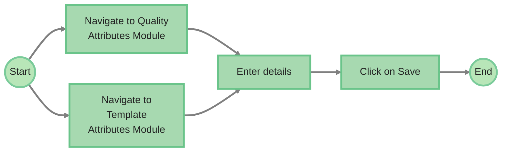
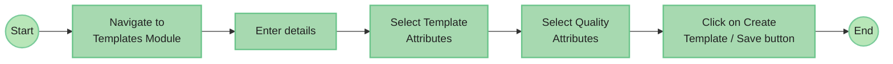
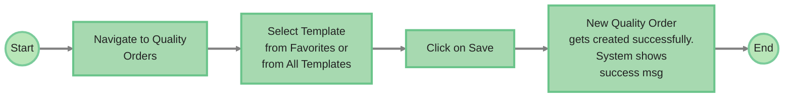
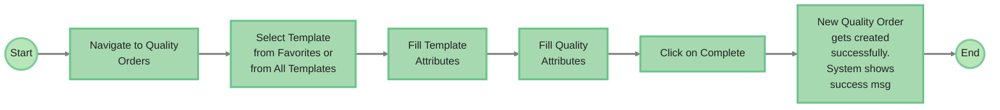
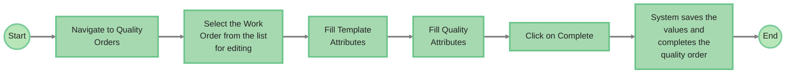

# AgriQuality Quality Management

**Processor Mobile and Desktop App**

Product Specifications Document — V 1.1

---

## Table of Contents

- [AgriQuality Quality Management](#agriquality-quality-management)
  - [Table of Contents](#table-of-contents)
  - [Revision History](#revision-history)
  - [Problem Statement](#problem-statement)
  - [Solution Overview](#solution-overview)
    - [Applications](#applications)
    - [In Scope](#in-scope)
    - [Out of Scope](#out-of-scope)
  - [Workflows](#workflows)
    - [Quality \& Template Attribute Creation](#quality--template-attribute-creation)
    - [Template Creation](#template-creation)
  - [UI \& UX (Wireframes \& Designs etc.)](#ui--ux-wireframes--designs-etc)
    - [UI \& UX features](#ui--ux-features)
  - [Quality Attributes](#quality-attributes)
    - [Main Screen](#main-screen)
      - [UI Components \& Features](#ui-components--features)
    - [Create / Update Screen](#create--update-screen)
      - [UI Components \& Features](#ui-components--features-1)
      - [Formula Validations](#formula-validations)
      - [Alerts on Number Range or Number Slider](#alerts-on-number-range-or-number-slider)
      - [Data Behavior](#data-behavior)
  - [Template Attributes](#template-attributes)
    - [Main Screen](#main-screen-1)
      - [UI Components \& Features](#ui-components--features-2)
      - [Data Behavior](#data-behavior-1)
    - [Create / Update Screen](#create--update-screen-1)
      - [UI Components \& Features](#ui-components--features-3)
      - [Behavior \& Validation](#behavior--validation)
      - [Data Behavior](#data-behavior-2)
  - [Templates](#templates)
    - [Main Screen](#main-screen-2)
      - [UI Components \& Features](#ui-components--features-4)
      - [Data Behavior](#data-behavior-3)
    - [Create / Update and Details / View Screen](#create--update-and-details--view-screen)
  - [App Users](#app-users)
    - [Persona 1 | Quality Manager](#persona-1--quality-manager)
    - [Quality Manager User Journey](#quality-manager-user-journey)
    - [Persona 2 | Quality Supervisor](#persona-2--quality-supervisor)
  - [Technical \& Other Details](#technical--other-details)
    - [Data Source Guidelines](#data-source-guidelines)
    - [List of Master Data](#list-of-master-data)
    - [Key Modules \& Features](#key-modules--features)
    - [Formula Calculations](#formula-calculations)
    - [Integrations](#integrations)
    - [Validation Rules, Error Handling \& Notifications](#validation-rules-error-handling--notifications)
  - [Use Cases](#use-cases)
  - [Future Considerations](#future-considerations)
- [Updates: v1.1](#updates-v11)
  - [App Users](#app-users-1)
  - [Quality Work Orders](#quality-work-orders)
    - [Workflows](#workflows-1)
    - [Quality Orders Main Screen](#quality-orders-main-screen)
      - [UI Components \& Features](#ui-components--features-5)
      - [Data Behavior](#data-behavior-4)
    - [Quality Orders - All Templates Screen](#quality-orders---all-templates-screen)
      - [UI Components \& Features](#ui-components--features-6)
      - [Data Behavior](#data-behavior-5)
    - [Quality Orders Details Screen](#quality-orders-details-screen)
      - [UI Components \& Features](#ui-components--features-7)
      - [Data Behavior](#data-behavior-6)
    - [Quality Manager \& Supervisor User Journey](#quality-manager--supervisor-user-journey)
    - [Integrations](#integrations-1)
  - [Setup / Settings Module](#setup--settings-module)
  - [Future Considerations](#future-considerations-1)
  - [References \& Appendices](#references--appendices)
    - [Reference Spreadsheets](#reference-spreadsheets)
    - [Prototype](#prototype)

---

## Revision History

| Date | Released By | Version | Revision Items |
|------|-------------|---------|----------------|
| 31-Dec-25 | Aqib Malik | 1.0 | Initial Release |

---

## Problem Statement

Current quality management processes rely on manual methods and disconnected systems, resulting in inconsistent data capture, lack of standardization, and limited traceability across receiving, production, and finished goods.

Quality checks are not systematically linked to operational data such as stockpiles, batches, or lots, and sampling logic, calculations, and validations are often handled manually, increasing the risk of errors.

Additionally, quality data is not fully integrated with warehouse and production systems, limiting real-time visibility and delaying operational decision-making.

This results in:

- Inconsistent quality data
- Limited traceability
- Delayed quality insights
- Weak system integration

A centralized and integrated quality management system is required to standardize processes, ensure traceability, and enable real-time quality monitoring.

---

## Solution Overview

AgriQuality is a centralized Quality Management System (QMS) that manages quality across receiving, production, and finished goods.

The system is built on a configurable, template-driven framework:

- **Quality Attributes** (e.g., moisture, FM, defects)
- **Template Attributes** (e.g., lot, sample, location, run)
- **Templates** (quality test definitions)
- **Quality Orders** (execution of samples/tests)
- **Fumigation** (execution of fumigation)

Quality processes support:

- Incoming sampling (receiving / stockpile)
- In-process production quality
- Equipment quality checks for calibration
- Finished goods quality

Quality Orders are linked to operational data (stockpiles, bins, runs, lots) and support multiple samples with calculations (averages, percentages, validations) to derive lot-level quality results.

The system integrates with:

- Warehouse systems for receiving and inventory data
- Production systems for runs and batch tracking
- Quality devices for automated data capture (future)

### Applications

- Web for configuration, monitoring, and management
- Mobile/Tablet for on-floor execution

### In Scope

- Quality management across receiving, production, and finished goods
- Creation and management of:
  - Quality Attributes
  - Template Attributes
  - Templates (quality test definitions)
- Quality Orders
- Fumigation Orders
- Capture and validation of quality data (manual and system-driven)
- Support for multiple samples and calculation of aggregated (lot-level) quality results
- Integration with:
  - Warehouse systems (receiving, stockpile, inventory data)
  - Production systems (runs, batches, tanks)
- Role-based applications:
  - Web (configuration, monitoring, management)
  - Mobile/Tablet (execution of quality checks)
- Real-time visibility of quality status, results, and compliance

### Out of Scope

- Financial processing or quality-based pricing adjustments
- External regulatory integrations (e.g., USDA systems)
- Fully automated IoT-based quality control or machine-driven decision-making (future phase)
- Advanced analytics, AI/ML-based grading, or predictive quality modeling

---

## Workflows

### Quality & Template Attribute Creation

Flow (Quality Manager → AgriQC Web App): Start → Navigate to Quality Attributes Module *or* Navigate to Template Attributes Module → Enter details → Click on Save → End.

### Template Creation

Flow (Quality Manager → AgriQC Web App): Start → Navigate to Templates Module → Enter details → Select Template Attributes → Select Quality Attributes → Click on Create Template / Save button → End.

---

## UI & UX (Wireframes & Designs etc.)

Prototype Application links:

1. <https://agrierp-quality-vb.folio3.site/>
2. ~~<https://agrierp-quality-mobile-vb.folio3.site/>~~ *(struck through in source)*

Final Design link: *[Yet to be inserted]*

### UI & UX features

1. Column options (hide, show columns) on tables. Users will be able to add & remove columns and save it as their preference (refer prototype).
2. Sorting of the columns on tables and ability to save it as preference on user level (refer prototype).
3. Two views of the tables i.e. table view and card view (refer prototype).
4. Drop down list view of growers, handlers, product type, variety, farming type (organic and conventional) and locations etc.

---

## Quality Attributes

The Quality Attributes module allows users to define and manage measurable quality parameters used across all quality templates. These attributes represent the core data points captured during quality processes (e.g., moisture, defects, size, weight).

Quality Attributes are centrally configured and reused across multiple templates to ensure consistency and standardization in quality data capture.

### Main Screen

#### UI Components & Features

The Quality Attributes main screen provides a centralized interface for viewing and managing all configured quality attributes. The screen supports multiple viewing options and actions to efficiently manage a large number of attributes.

**1. Attribute Listing**

The system supports two display modes for viewing quality attributes:

- **Card View (Default)**
  - Displays attributes in a card-based layout
  - Each card represents a single quality attribute
  - Suitable for quick visual scanning and understanding of attribute details
- **Grid View (Tabular View)**
  - Displays attributes in a structured table format
  - Suitable for managing large datasets and performing quick edits

Users can toggle between Card View and Grid View based on preference.

**2. Attribute Card Details / Grid Columns**

Each attribute (in both views) has the following data / columns:

- Attribute Name
- Attribute Type (e.g., number, slider, range)
- Description
- Unit (if applicable)
- Acceptable Range (if defined)
- Compliance rules (if configured)
- Created By
- Created Date
- Actions

**3. Search and Filtering**

- A search bar is available to filter attributes based on:
  - Name
  - Description
  - Type
- An expandable / collapsible filter panel will be there to filter on the following:
  - Name
  - Status
  - Type

**4. Grid Columns Options**

- Users can customize visible columns in the grid via show / hide columns options.
- Adjust column visibility based on preference
- Sort columns

**5. Grid Column Sorting and Filters**

Each column has the following options:

- Sorting column values
- Filter column values

**6. Pagination / Record Control**

- Users can control number of records displayed (e.g., 10 entries)
- Next or previous page to navigate through pages

**7. Create New Attribute**

- A "New Attribute" button is available
- Allows users to initiate creation of a new quality attribute

**8. Attribute Actions**

Each attribute supports the following actions:

- **Edit:** Modify attribute configuration. On card it will be an edit icon; on grid, users can edit by clicking on the grid row.
- **Disable:** A toggle to enable or disable attribute. Disabled attributes are not available for selection in templates or execution.
- **Clone/Copy:** An action to copy the attribute. Opens a new creation form with pre-filled data, named as [Copy of + Copied Template Name].

**9. Navigation**

The module is accessible via the left-side navigation panel.

### Create / Update Screen

The Create / Update screen for Quality Attributes allows users to define and configure new attributes or modify existing ones. This screen supports both simple and advanced attribute configurations, including formula-based attributes and compliance rules.

#### UI Components & Features

**1. Basic Attribute Information**

The following fields are used to define the core attribute details:

| Field | Type | Required | Description |
|-------|------|----------|-------------|
| Name | Text | Yes | Unique identifier for the quality attribute |
| Type | Dropdown | Yes | Defines how the attribute value will be captured (Text, number, number slider, range, Switch, Dropdown, Formula) |
| Description | Text Area | No | Provides additional context or explanation of the attribute |

**2. Quality Attribute Types**

Additional configuration fields are dynamically displayed based on the selected attribute type. The types are:

- **Text**
- **Number**
- **Number Slider** — three fields appear when this type is selected:
  - Min Value: Numeric field
  - Max Value: Numeric field
  - Unit: Dropdown
    - None
    - % (Percentage)
    - lb (Pounds)
    - ton
    - kg
    - Count
    - mm
    - inch
    - °F
    - °C
    - Gms
    - Pcs
- **Range** — the following fields appear when this type is selected:
  - Min Value: Numeric field
  - Max Value: Numeric field
  - Unit: Dropdown
    - None
    - % (Percentage)
    - lb (Pounds)
    - ton
    - kg
    - Count
    - mm
    - inch
    - °F
    - °C
    - Gms
    - Pcs
  - Allow values outside range with warning: Checkbox
    - Unchecked: Values outside range with an alert will be allowed
    - Checked: Values outside range will be blocked with a validation message
- **Switch:** Toggle
- **Dropdown** — the following field and button appear when Dropdown is selected:
  - Dropdown Options: Text field
  - Add button: Adds the dropdown value and opens a new field for the next dropdown value.
  - Users can mark one of the dropdown values as the default value, which will be pre-selected during execution *(future)*.
- **Formula** — the following two fields appear when Formula is selected as Type:
  - Formula: A field that allows the following to create a formula. This will be system calculated in Orders and will not appear for user input.
    - Numbers
    - Decimals
    - Arithmetic operators
    - Functions: SUM, AVG, MIN, MAX, IF, ROUND, ABS, COUNT
    - Selected Attributes
  - Attribute Selection: A list that shows all enabled attributes. Users can click to insert attribute references into the formula.

**3. Compliance Rules (Optional)**

- Users can define validation or compliance rules for the attribute. These will be a text / string that would later appear on the Quality Order, prominently displayed for this attribute.

**4. Action Controls**

- **Save:** Saves the attribute configuration. Validates required fields before saving.
- **Close / Cancel:** Allows user to exit without saving changes.

#### Formula Validations

Formula validation ensures:

- Correct syntax
- Valid attribute references
- Valid formula

#### Alerts on Number Range or Number Slider

On the range or number slider there will be user-input-based custom validation enforcement like the formula field. The user will be able to use other attributes to define the validation rule. This will be done by using functions. *(future)*

#### Data Behavior

- Attributes created are centrally available across all templates
- Updates to an attribute reflect wherever it is used
- Formula-based attributes depend on other attribute definitions and are evaluated during execution
- Disabled attributes are excluded from selection in templates and execution
- The system validates that the minimum value cannot be greater than the maximum value

---

## Template Attributes

The Template Attributes module allows users to define contextual data fields used within quality templates. These attributes capture metadata associated with quality processes, such as grower, field, location, date, and inspectors.

Template Attributes provide the contextual framework for quality data and ensure that all quality records are properly associated with operational entities.

### Main Screen

The Template Attributes main screen provides a centralized interface for managing all configured template attributes. The screen supports multiple viewing options to accommodate different user preferences.

#### UI Components & Features

**1. Attribute Listing**

The system supports two display modes:

- **Card View (Default)**
  - Displays attributes in a card-based layout
  - Each card represents a template attribute
  - Suitable for quick visualization of attribute configuration
- **Grid View (Tabular View)**
  - Displays attributes in a structured table format
  - Suitable for managing and reviewing large numbers of attributes

Users can toggle between Card View and Grid View.

**2. Attribute Card Details / Grid Columns**

Each attribute (in both views) has the following data / columns:

- Attribute Name
- Attribute Type (e.g., number, slider, range)
- Description
- Unit (if applicable)
- Created By
- Created Date
- Actions

**3. Search and Filtering**

- A search bar is available to filter attributes based on:
  - Name
  - Description
  - Type
- An expandable / collapsible filter panel will be there to filter on the following:
  - Name
  - Status
  - Type

**4. Grid Columns Options**

- Users can customize visible columns in the grid via show / hide columns options.
- Adjust column visibility based on preference
- Sort columns

**5. Grid Column Sorting and Filters**

Each column has the following options:

- Sorting column values
- Filter column values

**6. Pagination / Record Control**

- Users can control number of records displayed (e.g., 10 entries)
- Next or previous page to navigate through pages

**7. Create New Template Attribute**

- A "New Attribute" button is available
- Allows users to initiate creation of a new template attribute

**8. Attribute Actions**

Each attribute supports the following actions:

- **Edit:** Modify attribute configuration. On card it will be an edit icon; on grid, users can edit by clicking on the grid row.
- **Disable:** A toggle to enable or disable attribute.
- **Clone/Copy:** An action to copy the attribute. Opens a new creation form with pre-filled data, named as [Copy of + Copied Template Name].

**9. Navigation**

The module is accessible via the left-side navigation panel.

#### Data Behavior

- Template attributes define contextual fields used across templates
- These attributes are reused across multiple templates
- Updates to attributes are reflected wherever they are used

### Create / Update Screen

The Template Attribute Create / Update screen allows users to define and configure new template attributes or modify existing ones. These attributes define contextual data fields associated with quality processes.

#### UI Components & Features

**1. Basic Attribute Information**

The following fields are used to define the core attribute details:

| Field | Type | Required | Description |
|-------|------|----------|-------------|
| Name | Text | Yes | Unique identifier for the quality attribute |
| Type | Dropdown | Yes | Defines how the attribute value will be captured (Text, Number, Switch, Dropdown, Date) |
| Description | Text Area | No | Provides additional context or explanation of the attribute |

**2. Template Attribute Types**

The system validates that the minimum value cannot be greater than the maximum value.

- **Text**
- **Number**
- **Switch:** Toggle
- **Dropdown:** Refer to sub-section 2.1 below
- **Date:** By default, quality order would show current date
- **System Fetched attribute type:**
  - This type allows the system to automatically derive the value of an attribute based on another selected attribute.
  - For example, selecting a Stockpile Ticket can automatically fetch the associated Grower.
  - The user will configure the source attribute and select the corresponding field from the reference data.

**2.1. Dropdown (Template Attribute Type)**

When this type is selected by the user, there will be two options: either use dropdown values from a table in the system's database ("Reference Table") or use a manual table.

- **Reference Table:** This will be a dropdown that appears after the user selects dropdown type. This dropdown will show the following values / DB tables:
  - Growers
  - Fields
  - Variety
  - Location Types
  - Handlers
  - Stockpiles
  - Bins
  - Equipment
  - Inspectors / Resources
- **Custom Dropdown:** If the user does not select any reference table then they will have the option to define a custom dropdown list, which will have a field and an action:
  - Dropdown Options: Text field
  - Add button: Adds the dropdown value and opens a new field for the next dropdown value.
  - Users can mark one of the dropdown values as the default value, which will be pre-selected during execution. *(future)*
- **Note:** If a reference table is selected, manual dropdown entry will be disabled. Manual dropdown values can only be defined when no reference table is selected.

**3. Action Controls**

- **Save:** Saves the attribute configuration. Validates required fields before saving.
- **Close / Cancel:** Allows user to exit without saving changes.

#### Behavior & Validation

- Mandatory fields must be completed before saving
- Attribute name should be unique within the system
- System ensures valid configuration before saving

#### Data Behavior

- Template attributes are used across multiple templates
- Any updates to an attribute are reflected wherever it is used
- Required attributes enforce mandatory data capture during execution
- The system validates that the minimum value cannot be greater than the maximum value

---

## Templates

The Templates module allows users to define structured quality check configurations by combining Quality Attributes and Template Attributes. Templates define how quality inspections are performed and how data is captured during execution.

Templates serve as reusable configurations that standardize quality processes across receiving, stockpile, and production stages.

### Main Screen

The Templates main screen provides a centralized interface for managing all configured quality templates. The screen supports both card and grid views for efficient browsing and management.

#### UI Components & Features

**1. Template Listing**

The system supports two display modes:

- **Card View (Default)**
  - Displays templates in a card-based layout
  - Each card represents a single template
  - Suitable for quick understanding of template structure
- **Grid View (Tabular View)**
  - Displays templates in a structured table format
  - Suitable for managing multiple templates efficiently

**2. Template Card Details / Grid Columns**

Each template (in both views) has the following data / columns:

- Template Name
- Status (e.g., Active)
- Template Type (e.g., Quality Check, WIP/By Products Quality)
- Description
- Quality Attributes (displayed as tags)
- Template Attributes (displayed as tags with "+ more" option)
- Created Date
- View
- Edit
- Copy / Clone
- Delete

**3. Search and Filtering**

- A search bar is available to filter attributes based on:
  - Name
  - Description
  - Type
  - Quality Attributes
  - Template Attribute
- An expandable & collapsible filter panel will be there to filter on the following:
  - Name
  - Status
  - Type
  - Quality Attributes
  - Template Attribute

**4. Grid Columns Options**

- Users can customize visible columns in the grid via show / hide columns options.
- Adjust column visibility based on preference
- Sort columns

**5. Grid Column Sorting and Filters**

Each column has the following options:

- Sorting column values
- Filter column values

**6. Pagination / Record Control**

- Users can control number of records displayed (e.g., 10 entries)
- Next or previous page to navigate through pages

**7. Create New Template**

- A "New Template" button is available
- Allows users to initiate creation of a new template

**8. Attribute Actions**

Each attribute supports the following actions:

- **View:** Opens the template view screen.
- **Edit:** Modify attribute configuration. On card it will be an edit icon; on grid, users can edit by clicking on the grid row.
- **Disable:** A toggle to enable or disable attribute. Disabled attributes are not available for selection in templates or execution.
- **Clone/Copy:** An action to copy the attribute. Opens a new creation form with pre-filled data, named as [Copy of + Copied Template Name].

**9. Navigation**

The module is accessible via the left-side navigation panel.

#### Data Behavior

- Templates are reusable configurations
- Templates reference both:
  - Quality Attributes
  - Template Attributes
- Changes to attributes are reflected in templates automatically
- Template status controls availability during execution

### Create / Update and Details / View Screen

The Create / Update screen allows users to define a new template or modify an existing one. This screen enables configuration of template structure, attribute selection, and display behavior.

**1. Basic Information**

| Field | Type | Required | Description |
|-------|------|----------|-------------|
| Template Name | Text | Yes | Name of the template |
| Description | Text Area | No | Describes the purpose of the template |
| Type | Dropdown | Yes | Defines the template category (Incoming, Equipment Calibration, Process Other) |

**2. Template Attributes**

- Users can select template attributes to define contextual fields
- Attributes are selected from available list
- These fields are captured before quality inspection begins

Capabilities:

- Select / deselect attributes
- Search attributes
- Once selected:
  - Mark attributes visible / hidden (should be visible by default)
  - Mark attributes Editable / Read Only (editable by default)
  - Mark attributes as Mandatory / Not Mandatory (mandatory by default)

**3. Quality Attributes**

- Users select quality attributes that define the quality criteria
- Attributes are displayed as selectable tags

Capabilities:

- Select / deselect attributes
- Search attributes
- Once selected:
  - Mark attributes visible / hidden (should be visible by default)
  - Mark attributes Editable / Read Only (editable by default; formula attributes will be forced read only)
  - Mark attributes as Mandatory / Not Mandatory (mandatory by default)

**4. Form Action Controls**

- **Save:**
  - Validates required fields before submission
  - Saves the template in draft mode (draft can't be used on quality orders)
- **Save & Publish:**
  - Validates required fields before submission
  - Saves the template in active mode
- **Cancel:** Discards changes

**5. Behavior & Validation**

- Template must have:
  - At least one quality attribute
- Only active attributes are available for selection
- Template status controls usability in execution

**6. Data Behavior**

- Templates act as configuration layer for quality execution
- Templates combine:
  - Context (Template Attributes)
  - Measurements (Quality Attributes)
- Updates to attributes are reflected dynamically in templates
- Templates can be duplicated for reuse and modification

**7. Details / View Screen**

- Details screen will have the same fields as the creation / update form but these will be view-only.
- There will be a different UI than creation for a better experience. Refer to prototype or design.
- There will be the following fields in the header that are not in the creation form:
  - Created By
  - Created Date
  - Updated Date

---

## App Users

| App Access | Roles | Description |
|------------|-------|-------------|
| AgriQuality Web App | Quality Manager | Responsible for monitoring and managing quality operations, including reviewing quality orders, assigning work, tracking progress, and maintaining visibility of quality activities across receiving, stockpile, and production stages. |
| AgriQuality Mobile/Tab App | Quality Supervisor | Responsible for executing quality checks in the field or plant by selecting templates or assigned quality orders, entering template and quality attribute values, saving work in draft when needed, and completing quality orders. |

### Persona 1 | Quality Manager

**Name:** Nikki
**Role:** Quality Manager

**Responsibilities**

- Managing created quality control jobs
- Assigning jobs to appropriate resources
- Reviewing and monitoring all pending quality control jobs that remain incomplete
- Managing user access and permissions within the quality management system
- Defining and standardizing quality templates and attributes
- Ensuring consistency of quality parameters across processes

**Challenges**

- Manual data entry
- No real-time status of quality control

**Goals**

- Have easy and automated processes that make her life easier. Less manual effort.
- Easy and real-time visibility of the data, status, and progress of the quality.

### Quality Manager User Journey

**User:** Nikki — Quality Manager | AgriQuality Web Application

**Quality and Template Attribute creation — Nikki | Quality Manager**

1. Nikki logs in to the AgriQuality Web App.
2. Navigates to the Quality Attributes Module for quality attribute creation, or Template Attributes Module for template attribute creation.
3. Clicks on Create New Attribute.
4. Enters the required attribute details.
5. Clicks Save to create the attribute.
6. The attribute is successfully created.

**Template creation — Nikki | Quality Manager**

1. She navigates to the Template Module.
2. She enters details.
3. She selects the template attributes.
4. She selects the quality attributes.
5. She clicks on Create Template / Save button.
6. Templates are ready to be used in Quality Order.

### Persona 2 | Quality Supervisor

**Name:** John
**Role:** Quality Supervisor

**Responsibilities**

- Creating quality orders
- Completing quality orders

**Challenges**

- Monitoring job progress in real time across multiple operators, shifts, production, and receiving areas.
- Avoiding mistakes caused by unclear instructions, delayed updates, or miscommunication between teams.
- Ensuring operators follow the correct sequence of steps and accurately record required quality control details.

**Goals**

- Have clear and simple visibility into what needs to be scheduled, started, monitored, or completed.
- Minimize manual follow-ups, paper tracking, and repetitive status checks.

---

## Technical & Other Details

### Data Source Guidelines

AgriQuality is part of a broader ecosystem of applications supporting grower, processor, and handler operations. From a business perspective, reference and operational master data created within any application must be consistently available across all relevant applications (AgriERP, AgriWMS, Agri Quality, and Agri Production App). Users should not be required to recreate the same data in multiple systems.

How this is achieved is an architectural decision and may be implemented through a shared data source, synchronized databases, or other integration mechanisms. No design decisions should restrict the availability or flow of data between applications.

### List of Master Data

1. Growers
2. Handlers
3. Fields
4. Items
5. Variety
6. Locations
7. Stockpiles
8. Trailers
9. Bins
10. Equipment
11. Quality Attributes
12. Template Attributes
13. Templates

**Note:** Details for each master data entity are maintained in the Master Data spreadsheet: YHS - Master Data Structure.

### Key Modules & Features

This section contains two lists: a high-level overview of key modules and features, and a detailed breakdown of features and sub-features, ensuring both a broad scope and in-depth implementation guidance.

**1. High Level Modules & Features**

| Module | Platform | Description | Key Features & Details |
|--------|----------|-------------|------------------------|
| ~~Dashboard~~ | ~~Both~~ | | |
| Quality attributes | Web | Quality attributes to be added in quality work order templates | Quality attributes such as moisture content, foreign material (FM), size, etc., to be added in quality work order templates. |
| Template attributes | Web | Template attributes to be added in quality work order templates | Allows users to define and customize template attributes specific to quality control tasks, including fields for field run almonds, inshells, kernels, and farming. |
| Templates | Both | Templates to be used in quality work order | Defines standardized templates for quality control jobs to ensure consistent and repeatable assessments. |
| Quality Orders | Both | Performs quality tests | Supports various quality tests for materials throughout the process, ensuring compliance with quality standards such as incoming quality tests, process/production quality test. |
| USDA Sampling (Future Release - Handler) | Both | | Built in Handler Quality App, used here for processors also. |
| ~~Fumigation Order~~ | ~~Both~~ | | |
| Scanner | Both | Scanning | Stockpile scanning, Bin & serial label scanning, and trailer licence scanning. |
| Reports & Inquiries | Web | Generate reports | Generate the spreadsheets for quality orders data. |
| Profile | Both | Manage user preferences | Language, Security (Password & Pin), Preferences, Sign-out. |
| Settings | Web | Manage application settings | Master Data Management, User Management, Bulk Upload (future). |

### Formula Calculations

The AgriQuality application supports formula-based calculations within Quality Attributes to enable derived values based on user-entered inputs. Formulas can be optionally defined during Quality Attribute configuration and are evaluated at the time of data entry during quality execution.

This allows users to:

- Calculate derived quality values (e.g., percentages, averages, ratios)
- Reduce manual calculation errors

The following can be used in the formula:

- Other attributes
- Arithmetic operators (+ - * /)
- Functions:
  - SUM
  - AVG
  - MIN
  - MAX
  - IF
  - ROUND
  - ABS (Absolute)
  - COUNT

**Note:** Formula calculations are configured at the attribute level and are not editable during execution. Any updates to formulas are centrally managed and reflected across all applicable templates.

### Integrations

**1. Overview**

At the configuration level, AgriQuality integrates with shared master data across the AgriERP ecosystem to support setup of Quality Attributes, Template Attributes, and Templates.

**2. Master Data Integration**

The system consumes master data and transactional data for use in configuration:

- Growers
- Fields
- Variety
- Locations
- Handlers
- Stockpiles
- Bins
- Equipment
- Inspectors / Resources
- Production Run#

**3. Module Usage**

- **Template Attributes**
  - Use master data as reference tables for dropdown values
  - Integration for getting system-fetched attributes such as fetching of grower on the basis of stockpile ticket & production run#

**4. Out of Scope**

- Configuration (i.e., Template, Attributes) data push to external systems

### Validation Rules, Error Handling & Notifications

The following spreadsheet contains validation rules, errors & notifications:

- [AgriQuality | Errors, Validations, Notifications](https://docs.google.com/spreadsheets/d/14nbWwqq0EOL3jUu4ld5bWHq2H5xbiHSrUDCaQdEpEls/edit?gid=1925755163#gid=1925755163)

---

## Use Cases

The following spreadsheet contains the use cases. Refer to Use Cases and filter on App to filter out Production use cases.

| Use Case ID | Use Case | Handling |
|-------------|----------|----------|
| AG-01 | Create Quality Attribute | User navigates to Quality Attributes module, creates a new attribute by entering required details, and saves it. |
| AG-02 | Update Quality Attribute | User selects an existing quality attribute, updates details, and saves changes. |
| AG-03 | Define Formula for Attribute | User configures a formula for a quality attribute; system validates syntax and dependencies before saving. |
| AG-04 | Configure Compliance Rules | User defines validation or compliance rules for an attribute to enforce acceptable value ranges. |
| AG-05 | Create Template Attribute | User navigates to the Template Attributes module, creates a new attribute for contextual data, and saves it. |
| AG-06 | Update Template Attribute | User modifies an existing template attribute and saves the updated configuration. |
| AG-07 | Create Quality Template | User creates a new template by defining basic details and associating quality and template attributes. |
| AG-08 | Modify Quality Template | User edits an existing template to update attributes, sequence, or configuration. |
| AG-09 | Activate / Deactivate Template | User changes template status to control availability for execution. |
| AG-10 | Standardize Templates | User ensures templates are consistently defined and reused across processes. |
| AG-11 | Reuse Existing Attributes in Templates | User selects existing attributes while creating templates to maintain consistency. |
| AG-12 | Manage Configuration Centrally | User performs all attribute and template management through the web application. |
| AG-13 | Validate Template Before Saving | System ensures required configuration (e.g., attributes presence) before allowing template save. |

---

## Future Considerations

- Integration with external regulatory systems (e.g., USDA)
- Integration with inspection devices for automated data capture
- Advanced reporting and quality analytics (grower, field, stockpile, run)
- Historical trend analysis and quality performance tracking
- Template versioning and audit history for configuration changes

---

# Updates: v1.1

## App Users

| App Access | Roles | Description |
|------------|-------|-------------|
| AgriQuality Web App | Quality Manager | Responsible for monitoring and managing quality operations, including reviewing quality orders, assigning work, tracking progress, and maintaining visibility of quality activities across receiving, stockpile, and production stages. |
| AgriQuality Web App | Quality Supervisor | Responsible for executing quality checks in the field or plant by selecting templates or assigned quality orders, entering template and quality attribute values, saving work in draft when needed, and completing quality orders. |

## Quality Work Orders

### Workflows

**Create New Quality Work Order**

Figma Link: <https://www.figma.com/board/uLk10wVnQDFNkncF6TDcI1/Vann-Phase3-Internal?node-id=11873-14385&t=qo0As3pE51awVcTk-4>

Flow (Quality Manager → AgriQC Web App): Start → Navigate to Quality Orders → Select Template from Favorites or from All Templates → Click on Save → New Quality Order gets created successfully, system shows success msg → End.

**Submit Completed New Quality Work Order**

Figma Link: <https://www.figma.com/board/uLk10wVnQDFNkncF6TDcI1/Vann-Phase3-Internal?node-id=11873-14668&t=qo0As3pE51awVcTk-4>

Flow (Quality Manager → AgriQC Web App): Start → Navigate to Quality Orders → Select Template from Favorites or from All Templates → Fill Template Attributes → Fill Quality Attributes → Click on Complete → New Quality Order gets created successfully, system shows success msg → End.

**Complete Existing Quality Work Order**

Figma Link: <https://www.figma.com/board/uLk10wVnQDFNkncF6TDcI1/Vann-Phase3-Internal?node-id=11874-14881&t=qo0As3pE51awVcTk-4>

Flow (Quality Manager → AgriQC Web App): Start → Navigate to Quality Orders → Select the Work Order from the list for editing → Fill Template Attributes → Fill Quality Attributes → Click on Complete → System saves the values and completes the quality order → End.

### Quality Orders Main Screen

The Quality Orders main screen provides a centralized interface to create, track, and manage all quality orders. It enables users to quickly initiate inspections, monitor progress, and access existing quality records efficiently.

#### UI Components & Features

**1. Favorite Templates Section**

A quick-access section is available at the top of the screen to initiate quality orders using frequently used templates.

- Displays templates marked as favorites
- Each template is shown as a selectable card/button
- Users can directly create a quality order by selecting a template
- "Add Favorite" option allows users to add additional templates to the favourites list
- "View All Templates" link redirects to full template listing
- Horizontal scroll/slider available for multiple templates
- Each template card includes:
  - Name of the template
  - Template type
  - Count of attributes
  - Favorite Icon (⭐):
    - Users can unmark templates as favorites, after which the template will disappear from this screen

**2. Quality Orders Listing**

The system supports two display modes:

- **Grid View (Default)**
  - Displays quality orders in a structured tabular format
  - Suitable for managing and reviewing large volumes of records
- **Card View**
  - Displays each quality order as a card
  - Provides a more visual and summary-based layout
  - Suitable for quick review and mobile/tablet usage

**3. Quality Order Columns / Card Details**

Each quality order (in both views) includes the following data:

- Quality Order Number
- Type (e.g., Almond Receiving, Process Quality, Inspection)
- Template Name
- Created Date
- Created by
- Status (To Do, Completed)
- All attributes (only for grid)
- Actions

**4. Search and Filtering**

A search bar is available to filter quality orders based on:

- Work Order Number
- Type
- Template Name

An expandable & collapsible filter panel is available with the following filters:

- Quality Order Number
- Type
- Template
- From Date
- To Date
- Created By
- Status (All, Draft, Completed, etc.)
- All Attributes
  - If attribute is dropdown, then dropdown values as filter
  - If attribute is numeric, range, or number slider, then range as filter
  - If attribute is date, then date range as filter
  - Else should be a text box

**5. Grid Column Options**

Users can customize visible columns in the grid:

- Show / hide columns
- Adjust column visibility based on user preference
- Save personalized column views
- Sorting of columns in grid

**6. Grid Column Sorting and Filters**

Each column supports:

- Sorting (ascending / descending)
- Column-level filtering

**7. Pagination / Record Control**

- Users can control number of records displayed (e.g., 10 entries)
- Navigate between pages using pagination controls

**8. Export Functionality**

- "Export to Excel" option available
- Exports filtered (one template at a time) quality orders in an Excel file (the selected columns — Quality Orders with attributes — can be exported)

**9. Quality Order Actions**

Each quality order supports the following actions based on status:

- **View:** Open completed quality order in read-only mode
- **Edit:** Modify draft or in-progress quality orders
- **Void:** Voids the quality orders

**10. Navigation**

- Accessible via left-side navigation panel
- Integrated with:
  - Templates
  - Quality Attributes
  - Template Attributes

#### Data Behavior

- Quality Orders are transaction records created using templates
- Each quality order inherits:
  - Template Attributes
  - Quality Attributes
- Favorite templates act as shortcuts and do not store data themselves
- All the quality orders are editable, even the completed ones
- Changes in templates or attributes apply only to new quality orders, not existing ones
- Data is searchable, filterable, and exportable

### Quality Orders - All Templates Screen

The All Templates screen provides a centralized interface for selecting a template to create a new quality order. It enables users to browse, search, and quickly initiate inspections using available templates.

#### UI Components & Features

**1. Template Listing**

The system supports a card-based layout for template selection:

- Each template is displayed as a card
- Designed for quick visual identification and selection
- Optimized for usability during execution
- Only active templates appear here for selection

Unlike the Templates module, this screen is selection-focused, not configuration-focused.

**2. Template Card Details**

Each template card contains the following:

- Template Name (e.g., Bin QA, Appearance Inspection)
- Template Type
- Count of Attributes
- Favorite Icon (⭐):
  - Users can mark/unmark templates as favorites
  - Favorites appear in the main Quality Orders screen

**3. Search Functionality**

A search bar is available at the top. Users can search templates based on:

- Template Name
- Template Type

Search dynamically filters visible template cards.

**4. Template Selection**

- Clicking on a template card selects it
- System proceeds to: → Refer to Quality Order creation flow (Template Attributes screen)

**5. Favorites Management**

- Star icon on each template allows marking as favorite
- Favorite templates:
  - Appear in "Favorite Templates" section on main screen
  - Provide quick access for frequently used inspections

**6. Navigation**

- Left navigation panel > Quality Orders > "View All Templates"

#### Data Behavior

- Only Active Templates are displayed and selectable
- Templates are fetched from the Templates module
- Each template includes:
  - Associated Quality Attributes
  - Associated Template Attributes
- Selecting a template:
  - Does not modify template configuration
  - Only initializes a new quality order instance
- Favorites are user-specific preferences (not global system data)

### Quality Orders Details Screen

The Quality Order Details screen allows users to view, create, update, and complete a quality order based on the selected template. It serves as the primary interface for capturing inspection data and managing execution.

#### UI Components & Features

**1. Template Assignment Section**

There is a single dropdown field in this section that shows the template.

**3. Template Attributes Section**

Captures contextual metadata before the quality begins.

- **Features**
  - Section header displays:
    - Template name reference
    - Count of attributes (e.g., "8 fields")
  - Expandable / collapsible section
- **Supported Input Types**
  - Date
  - Number
  - Text
  - Any other type defined in the quality attribute section
- **Behavior**
  - Fields are dynamically loaded based on selected template
  - Supports different input types depending upon template and quality attribute type such as dropdown, date, text, formula calculated, and system-fetched values, etc.
  - Mandatory behavior is controlled at **Template level (not Template Attribute level)**

**5. Quality Attributes Section**

Captures inspection measurements and results.

- **Features**
  - Section header displays:
    - Number of attributes (e.g., "2 attributes")
  - Expandable / collapsible section
- **Supported Input Types**
  - Number
  - Range
  - Text
  - Formula-based (calculated fields)
  - Any other type defined in the quality attribute section

**6. Validation & Alerts**

- Real-time validation on data entry:
  - Range validation (min/max) — validation or alert based on what is selected on quality attributes
  - Mandatory fields enforcement
- Non-blocking warnings for out-of-range values (configurable)
- Disabled formula fields auto-calculate based on dependent attributes

**7. Actions**

Available actions depend on the state of the quality order:

- **Save (To Do):** Saves entered data without completing
- **Submit (Completed):**
  - Marks quality order as completed
  - Triggers validations before submission
- **Cancel:** Cancels the quality order (if not completed)

**8. Navigation**

- Accessible from:
  - Quality Orders main screen (Edit/View)
  - Template selection flow (Create)
- Left navigation panel remains consistent across modules

#### Data Behavior

- Quality Order is initiated / created by selecting a template
- System loads:
  - Template Attributes → Metadata
  - Quality Attributes → Inspection fields
- Template changes do **not** impact existing quality orders
- Data entered is stored against the specific work order instance
- Formula attributes:
  - Auto-evaluated based on dependent fields
  - Cannot be manually overridden
- Completion:
  - Still available for further edit and updates
  - Enables audit/history tracking (future-ready)

### Quality Manager & Supervisor User Journey

**Quality Order creation — Nikki | Quality Manager or John | Quality Supervisor**

1. Nikki or John logs in to the AgriQuality Web App.
2. Navigates to the Quality Orders module.
3. Chooses a template:
   a. Selects from Favorites, or
   b. Browses and selects from All Templates
4. Clicks on Save to create the quality order.
5. The system creates the quality order successfully and displays a confirmation message.

**Submit Completed New Quality Order — Nikki | Quality Manager or John | Quality Supervisor**

1. Nikki or John logs in to the AgriQuality Web App.
2. Navigates to the Quality Orders module.
3. Chooses a template:
   a. Selects from Favorites, or
   b. Browses and selects from All Templates
4. Fills in the Template Attributes.
5. Fills in the Quality Attributes.
6. Clicks on Complete to submit the quality order.
7. The system creates and submits the quality order successfully and displays a confirmation message.

**Complete Existing Quality Order — Nikki | Quality Manager or John | Quality Supervisor**

1. Nikki or John logs in to the AgriQuality Web App.
2. Navigates to the Quality Orders module.
3. Selects an existing quality order from the list for editing.
4. Fills in the Template Attributes.
5. Fills in the Quality Attributes.
6. Clicks on Complete to finalize the quality order.
7. The system saves the entered values and completes the quality order successfully.

### Integrations

**Overview**

The Quality Orders module integrates with upstream systems to enable creation, execution, and tracking of quality inspections in alignment with operational processes.

This ensures that quality activities are linked with real-time operational data such as stockpiles, receiving loads, and production runs.

**Integrated Systems**

**1. Integration with Locations & Receiving module (Locations & Receiving > Quality Orders)**

- **Purpose:**
  - To provide receiving and stockpile-related data for incoming quality
- **Data Used:**
  - Stockpile / Location
  - Stockpile ticket
- **Usage:**
  - Referencing the data in the attributes
  - Linking quality orders to stockpiles or locations
  - Supporting quality checks during receiving and storage

**2. Integration with Inventory Module (Quality Orders > Inventory)**

- **Purpose:** To associate quality results with inventory for traceability, filtration, and analysis.
- **Data Used:**
  - Stockpile Ticket
  - Production Run #
  - Attributes
- **Usage:**
  - Referencing inventory identifiers within template attributes
  - Linking attributes to stockpiles and production batches
  - Mapping inspection results to corresponding inventory records
  - Supporting traceability of quality across receiving, storage, and processing stages

**3. Production Module (Production > Quality Orders)**

- **Purpose:** To support process quality checks.
- **Data Used:** Production Run#, GFV based on run#
- **Usage:**
  - Associating quality orders with production runs
  - Enabling process-level quality inspections

**4. Master Data (Shared Across AgriERP Suite)**

- **Purpose:** To ensure consistency in reference data.
- **Data Includes:**
  - Growers
  - Fields
  - Variety
  - Locations
  - Inspectors / Users
- **Usage:**
  - Populating template attributes during quality order execution
  - Ensuring standardized data capture

**Data Interaction Model**

- Quality Orders consume data from external systems for reference and linkage
- All reference values are dynamically populated based on system availability
- Quality Orders share attribute-level data to external systems

**Integration Behavior**

- Reference data (e.g., stockpile, production run) is selected during execution
- Data visibility is limited to active and relevant records

**Validations & Error Handling**

The following spreadsheet contains validation rules, errors & notifications:

- AgriQuality | Errors, Validations, Notifications

**Use Cases**

The following are the use cases for quality orders:

| Use Case ID | Use Case | Handling |
|-------------|----------|----------|
| AG-14 | Create Quality Order | User navigates to the Quality Orders module, selects a template from Favorites or All Templates, and creates a new quality order. |
| AG-15 | Fill Template Attributes | User enters required template attributes (metadata) before proceeding with the quality inspection. |
| AG-16 | Fill Quality Attributes | User enters inspection values for quality attributes as defined in the selected template. |
| AG-17 | Submit Quality Order | User completes the quality order by clicking on Complete after entering all required values. |
| AG-18 | Validate Quality Data | System validates entered values against defined rules (mandatory fields, ranges, data types) before allowing completion. |
| AG-19 | Calculate Formula Attributes | System automatically calculates formula-based attributes based on dependent values during data entry. |
| AG-20 | Edit Existing Quality Order | User selects an existing open quality order, updates attribute values, and saves changes. |
| AG-21 | Complete Existing Quality Order | User completes an existing quality order after entering or updating required values. |
| AG-22 | Allow Editing of Completed Orders | System allows users to modify completed quality orders and enforces read-only behavior. |
| AG-23 | Handle Validation Errors | System displays appropriate error or warning messages when entered values are invalid or outside acceptable limits. |

## Setup / Settings Module

The setup, configurations, master data management, and user permissions & management will be administered centrally via an Admin portal, which will be addressed via separate product spec documentation.

## Future Considerations

- Integration with external regulatory systems (e.g., USDA)
- Integration with inspection devices for automated data capture
- Advanced reporting and quality analytics (grower, field, stockpile, run)
- Historical trend analysis and quality performance tracking
- Template versioning and audit history for configuration changes
- Enable mobile/tablet interface for field users
- USDA Sampling: Targeted for handler AgriQuality application and to be used here (for processor) as well
- Integration with Warehouse and Production systems for automatic creation of quality orders
- Support for auto-triggered quality orders based on predefined conditions
- Integration with barcode/QR scanning for quick identification
- Support for offline data capture with later synchronization
- Addition of approval workflows for completed quality orders
- Ability to attach images or documents during inspection
- Support for alerts and notifications based on threshold breaches
- Enable bulk quality order creation and updates
- Automatic creation of quality orders from external systems

---

## References & Appendices

### Reference Spreadsheets

Below are the reference spreadsheets:

- [Features List](https://folio30.sharepoint.com/sites/VannBroandF3/_layouts/15/AccessDenied.aspx?Source=https%3A%2F%2Ffolio30.sharepoint.com%2F%3Ax%3A%2Fr%2Fsites%2FVannBroandF3%2F_layouts%2F15%2Fdoc.aspx%3Fsourcedoc%3D%257B9fb600d7-1b9a-4305-81bd-2175a8d0e44b%257D%26action%3Dedit&correlation=93be20a2-7093-1001-d51c-a6bf206443c2&Type=item&name=53ec3160-9860-4ba8-8d15-bb27e589215e&listItemId=970&listItemUniqueId=9fb600d7-1b9a-4305-81bd-2175a8d0e44b&allowautoredirecttosource=true)
- [Master Data Structure](https://docs.google.com/spreadsheets/d/1uwVpx6gMC9G1OoGSDboQU826b9FrJIt9tgvgUUoqMIU/edit?gid=468545135#gid=468545135)
- [YHS - Enums, Mappings, Other Config Data](https://docs.google.com/spreadsheets/d/1Bq-fPXFwUsJirXLPtHkuOVhTr_p4__xnAviArysV4rQ/edit?gid=1026061957#gid=1026061957)
- [YHS QC - Creation/Details Form Fields](https://docs.google.com/spreadsheets/d/1ioYWmiHwAzDgaLjQ8j3k2jIyXB_AglamOfcw73m3zE4/edit?gid=1593590681#gid=1593590681)
- [Errors, Validations & Notifications](https://docs.google.com/spreadsheets/d/14nbWwqq0EOL3jUu4ld5bWHq2H5xbiHSrUDCaQdEpEls/edit?gid=1925755163#gid=1925755163)
- [Statuses](https://docs.google.com/spreadsheets/d/1pU89XZq72XGwTXRKQ2q3rSjQFEH7AW5e9J8wbZC7gCs/edit?gid=609536326#gid=609536326)

### Prototype

Prototype Link: AgriProduction - Farm Management
