# YHS FRD — Process Diagrams

Mermaid diagrams derived from **FRD - Vann Phase 3 - YHS.md** (Yolo Hulling & Shelling Co.).
Covers the full field-run → kernel/inshell shipment pipeline, byproduct streams,
process state machines, and requirement traceability.

---

## 1. Master Material Flow (End-to-End)

High-level flow of almond material from grower delivery to VFO shipment, including
all byproduct streams (hulls, shells, meats, dirt/stone).

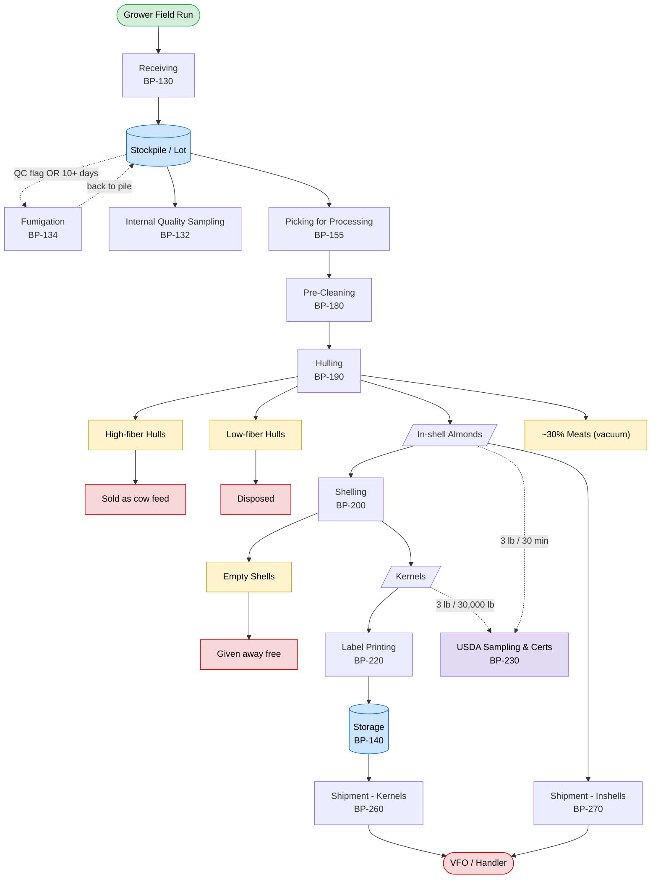

---

## 2. Receiving Process (BP-130)

Truck weigh-in → stockpile ticket → location assignment → unload → weigh-out.

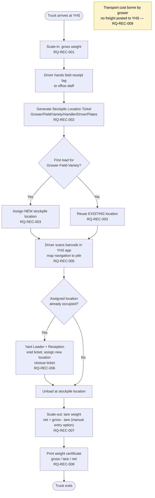

---

## 3. Fumigation (BP-134)

Triggered by QC decision or 10+ day dwell; cost absorbed by YHS overhead.

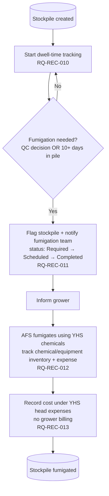

---

## 4. Production: Picking → Pre-Cleaning → Hulling → Shelling (BP-155/180/190/200)

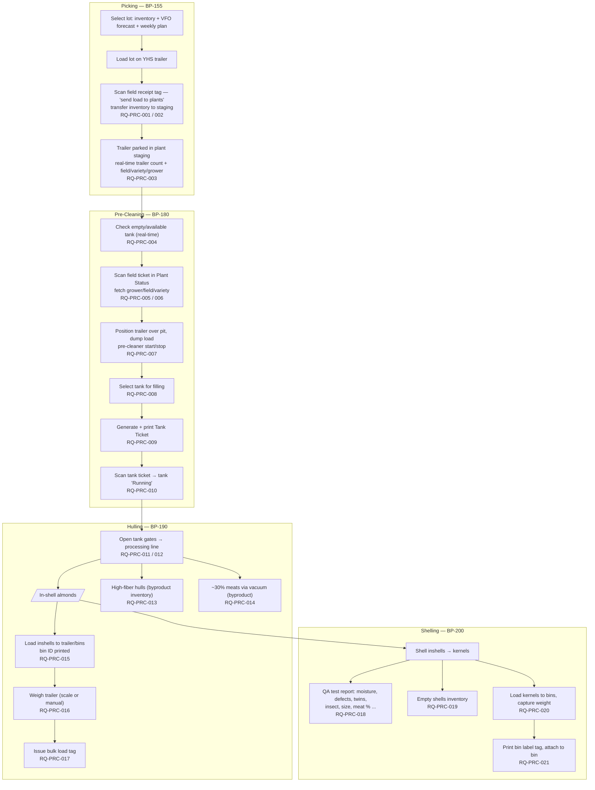

---

## 5. Label Printing (BP-220)

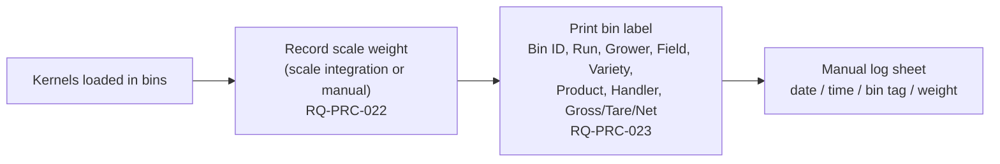

---

## 6. Shipment — Kernels (BP-260)

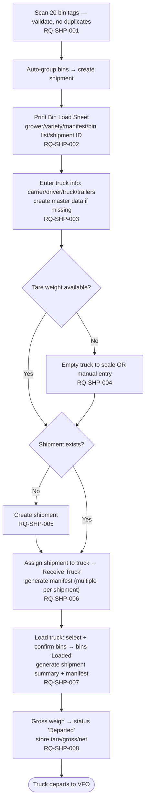

---

## 7. Shipment — Inshells (BP-270)

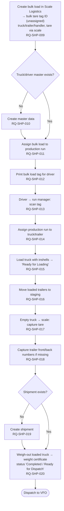

---

## 8. State Machines

### 8a. Stockpile (Lot) Lifecycle

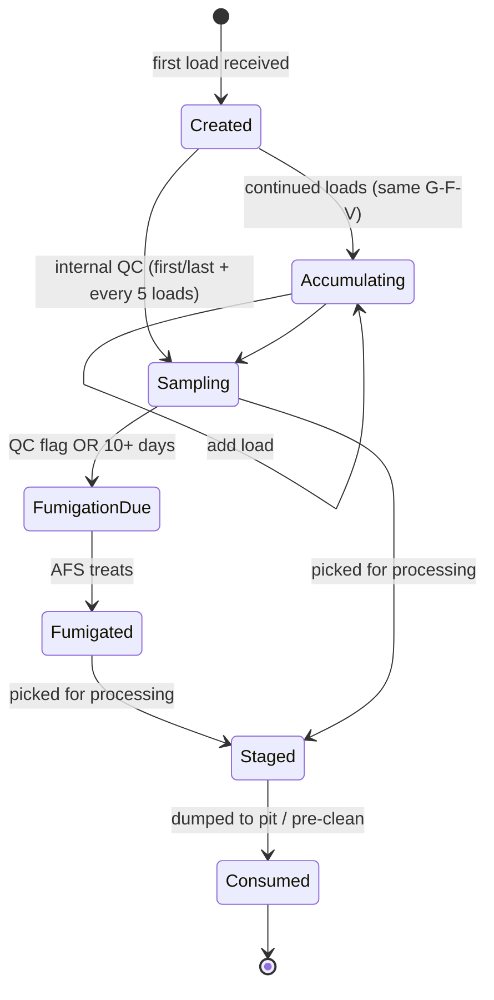

### 8b. Tank Status (BP-180-07)

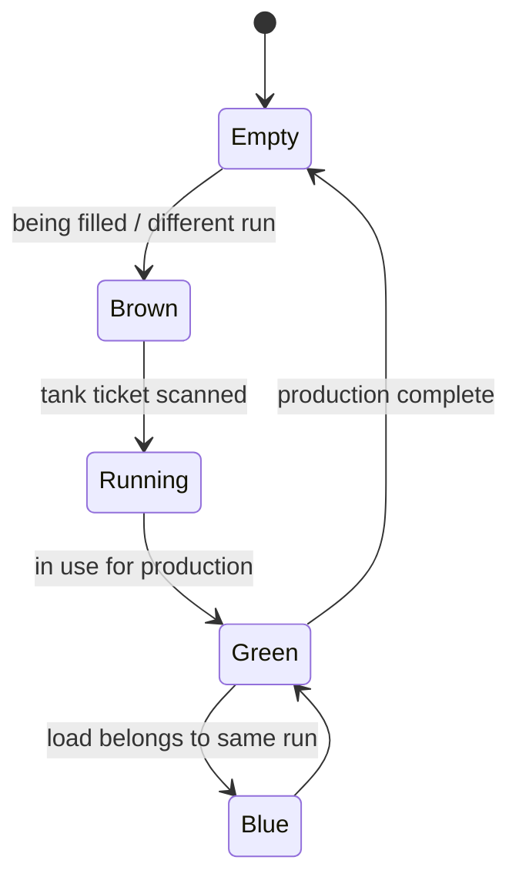

### 8c. Fumigation Status (RQ-REC-011)

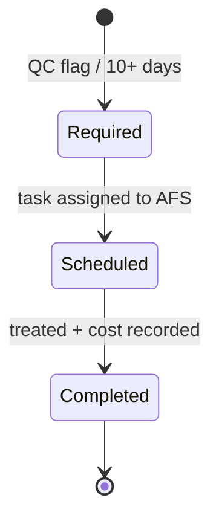

### 8d. Shipment Status (BP-260 / BP-270)

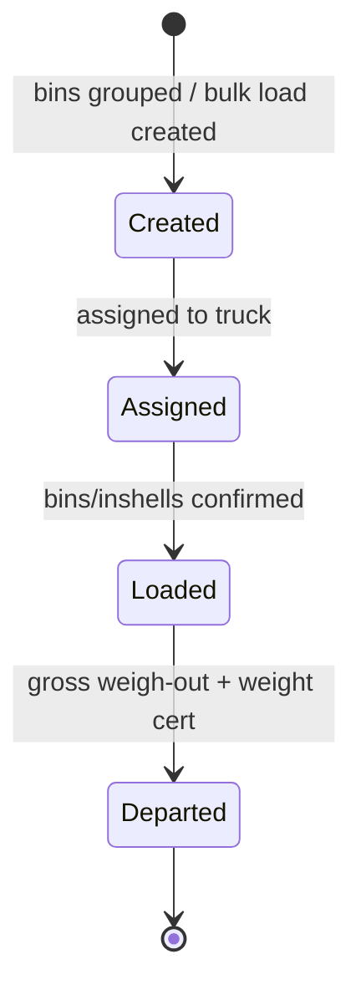

---

## 9. Requirement Traceability Map

Requirement IDs grouped by area (33 functional requirements total).

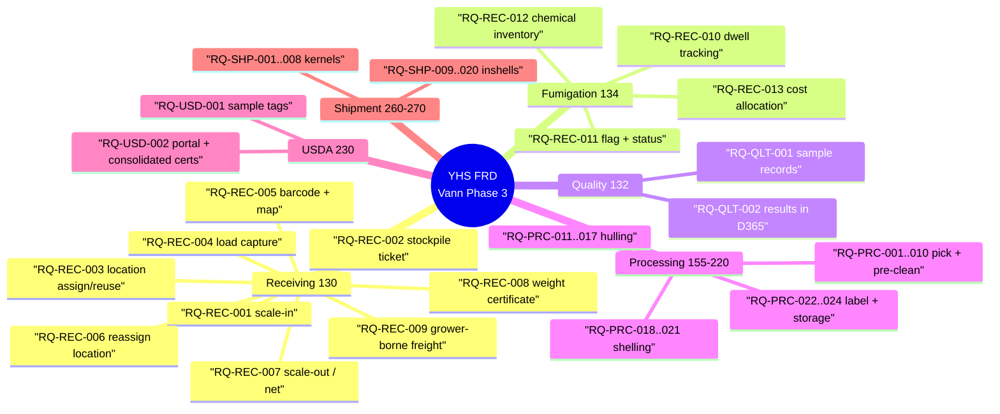

---

## 10. Byproduct / Disposition Summary

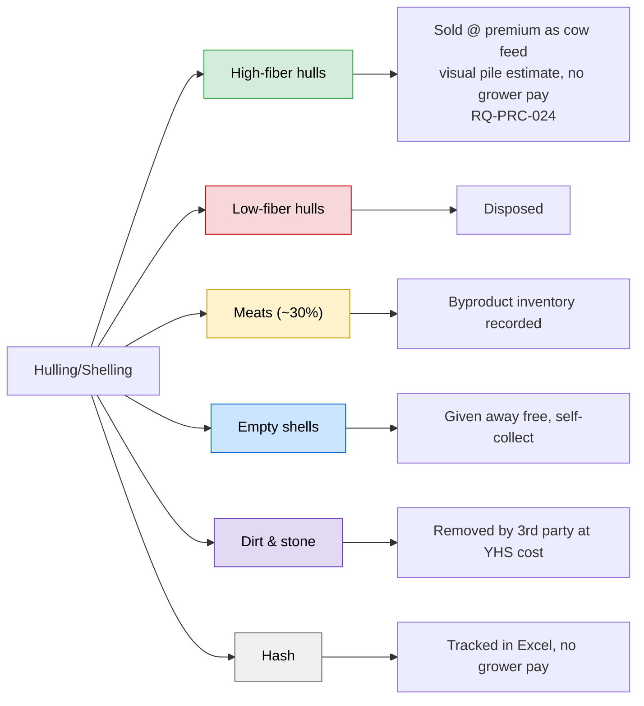
